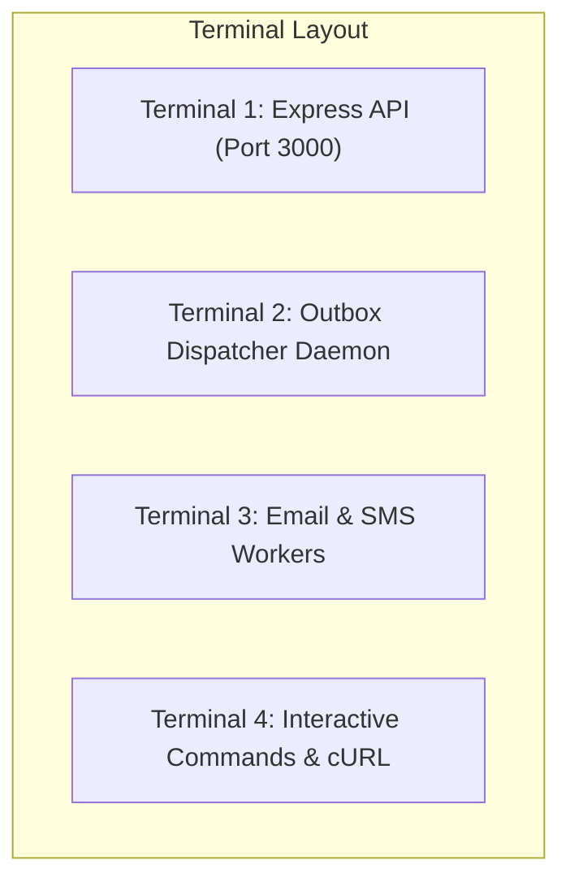

# Relay — 10-Minute Graduation Demo Guide

**Dev and Design HQ Product Design & Engineering Bootcamp**  
**Project:** Relay Notification Infrastructure Prototype  
**Audience:** Technical Evaluation Panel, System Architecture Reviewers, and Hiring Committees  
**Target Duration:** 10 Minutes (Strictly Timed)  
**Document Version:** 1.0.0 (October 2026)

---

## 1. Executive Summary & Demo Goals

This script guides a presenter through a rigorous, high-impact **10-minute live demonstration** of the Relay notification infrastructure. 

By the end of this presentation, the evaluation panel will observe live verification of:
1. **Durable Ingestion & Transactional Outbox:** Zero dual-write message loss; atomic commit of notification, idempotency record, and outbox event with `HTTP 202 Accepted`.
2. **Idempotency Guarantees:** Tenant-scoped idempotency handling sequential replays (`isReplay: true`) and rejecting conflicting payloads (`HTTP 409 IDEMPOTENCY_CONFLICT`).
3. **Asynchronous Lifecycle & Observability:** Outbox polling, BullMQ worker claiming, PostgreSQL state transition to `processed`, and live Prometheus metrics scraping.
4. **Dual-Stage Tenant Fairness:** Elimination of Head-of-Line (HoL) blocking via PostgreSQL Interleaved Round-Robin (IRR) claiming and Redis Lua Dynamic Tenant Concurrency Control (DTCC).
5. **Overload Protection & Self-Healing:** Fast-path admission control (`HTTP 503 SYSTEM_OVERLOADED`) with rate-limit token refunds and automatic recovery following infrastructure stalls.

---

## 2. Pre-Demo Environment Checklist

Execute these verification checks **15 minutes before the presentation**:

| Check Item | Requirement | Verification Command | Expected Result |
| :--- | :--- | :--- | :--- |
| **Node.js Runtime** | Node.js v20.x or higher | `node -v` | `v20.x.x` or higher |
| **TypeScript Build** | Clean build (0 errors) | `npm.cmd run build` | Exits with code 0 |
| **PostgreSQL Connection** | Neon Cloud Database reachable (migrations `001_initial.sql` through `006_notification_preferences.sql` applied) | `npx.cmd tsx src/database/check-connection.ts` | `Database connection successful!` |
| **Redis Server** | Redis running locally | `redis-cli -p 6386 ping` (or port in `.env`) | `PONG` |
| **Port Availability** | Ports 3000 (API) available | `netstat -ano \| findstr :3000` | No conflicting listener |
| **Regression Suite** | All automated tests passing | `npm.cmd test` | `95 passed (95)` across 11 test files |

> [!TIP]
> **Port Note:** Relay's `.env` is pre-configured to connect to local Redis on port `6386` (or `6379`). Ensure your local Redis instance matches the `REDIS_URL` in `.env`.

---

## 3. Component Startup Procedure

Open **four dedicated terminal windows** arranged side-by-side to showcase decoupled processing in real time:



### Terminal 1: API Server
```bash
cd c:\Users\HP\Desktop\relay-system
npm run dev
```
*Expected log:* `[Server] Relay API listening on port 3000`

### Terminal 2: Outbox Dispatcher Daemon
```bash
cd c:\Users\HP\Desktop\relay-system
npm run dispatcher
```
*Expected log:* `[Dispatcher] Outbox dispatcher running with batchSize=10, interval=1000ms`

### Terminal 3: Email and SMS Worker Pool
```bash
cd c:\Users\HP\Desktop\relay-system
npm run workers
```
*Expected log:* `[Workers] Started email and sms workers (concurrency=5)`

### Terminal 4: Lease Reconciliation Daemon (Optional Background Service)
```bash
cd c:\Users\HP\Desktop\relay-system
npm run reconcile
```
*Expected log:* `[Reconciliation] Scanner running with interval=5000ms, leaseTimeout=60000ms`

*(Terminal 4 can also be reserved for submitting live cURL commands and database queries).*

---

## 4. 10-Minute Presentation Timeline

```
00:00 ─── 01:30  [1.5 min] Architecture & Problem Overview
01:30 ─── 03:30  [2.0 min] Live Ingestion & Idempotency Demo
03:30 ─── 05:00  [1.5 min] Outbox Dispatch, Worker Drain & Metrics
05:00 ─── 07:30  [2.5 min] Multi-Tenant Fairness Defense & Benchmark Evidence
07:30 ─── 09:00  [1.5 min] Overload Protection & Redis Resilience
09:00 ─── 10:00  [1.0 min] Trade-offs, Scalability & Q&A
```

---

## 5. Minute-by-Minute Script & Command Execution

### Minute 0:00 – 01:30 | Architecture & Problem Overview
**Speaker Narrative:**
> *"Welcome everyone. Today I am presenting Relay, a high-reliability notification infrastructure prototype designed to address the distributed systems challenges of ingesting, scheduling, and delivering notifications under heavy multi-tenant load.*
>
> *At scale, naive notification architectures suffer from three fatal flaws: First, the dual-write problem—writing to a database and directly publishing to a broker can silently drop messages if the network or broker fails mid-request. Second, noisy-neighbor starvation—a single tenant submitting 100,000 marketing messages clogs FIFO queues, delaying time-critical OTPs from other tenants. Third, cascading collapse—unbounded ingress during downstream provider stalls overwhelms databases.*
>
> *Relay solves these with three core mechanisms: the Transactional Outbox pattern in PostgreSQL for atomic durability, dual-stage tenant fairness across SQL claims and Redis Lua concurrency slots, and fast-path admission backpressure. Let's see this running live."*

---

### Minute 01:30 – 03:30 | Live Ingestion & Idempotency Demo
**Action:** Switch to Terminal 4 and submit a valid notification via cURL.

#### Demo Step 1: Valid Notification Submission (HTTP 202 Accepted)
Run:
```bash
curl -i -X POST http://localhost:3000/v1/notifications \
  -H "Content-Type: application/json" \
  -H "Idempotency-Key: demo-key-001" \
  -d '{
    "customerId": "d600ffb8-91ac-46ec-8837-c8455c9ffe5b",
    "recipient": "evaluator@example.com",
    "channel": "email",
    "payload": {
      "subject": "Bootcamp Graduation Review",
      "body": "Relay live demonstration notification"
    }
  }'
```

**Show on Screen:**
```http
HTTP/1.1 202 Accepted
Content-Type: application/json; charset=utf-8
RateLimit-Limit: 100
RateLimit-Remaining: 99
RateLimit-Reset: 60

{
  "id": "e4f8b2c1-...",
  "customerId": "d600ffb8-91ac-46ec-8837-c8455c9ffe5b",
  "recipient": "evaluator@example.com",
  "channel": "email",
  "status": "pending",
  "createdAt": "2026-10-29T12:00:00.000Z"
}
```
**Key Point to Explain:**
> *"The API returned HTTP 202 in under 50 milliseconds. Crucially, the notification record, outbox event, and idempotency key were committed together within a single atomic PostgreSQL transaction. No message was published directly to Redis during this request; our durable acceptance guarantee is completely decoupled from broker availability."*

#### Demo Step 2: Identical Replay (Safe Idempotency)
Re-run the exact same command:
```bash
curl -i -X POST http://localhost:3000/v1/notifications \
  -H "Content-Type: application/json" \
  -H "Idempotency-Key: demo-key-001" \
  -d '{
    "customerId": "d600ffb8-91ac-46ec-8837-c8455c9ffe5b",
    "recipient": "evaluator@example.com",
    "channel": "email",
    "payload": {
      "subject": "Bootcamp Graduation Review",
      "body": "Relay live demonstration notification"
    }
  }'
```

**Show on Screen:**
```http
HTTP/1.1 202 Accepted
...
{
  "id": "e4f8b2c1-...",
  "customerId": "d600ffb8-91ac-46ec-8837-c8455c9ffe5b",
  "recipient": "evaluator@example.com",
  "channel": "email",
  "status": "pending",
  "isReplay": true
}
```
**Key Point to Explain:**
> *"Notice `"isReplay": true`. Relay matched the composite unique key `(customerId, Idempotency-Key)` and verified the SHA-256 payload hash. It returned the existing record without creating a duplicate outbox event or re-queuing a background job. Furthermore, the consumed rate-limit token was atomically refunded via Redis ZREM."*

#### Demo Step 3: Conflicting Payload Replay (Idempotency Conflict)
Modify the payload while reusing `Idempotency-Key: demo-key-001`:
```bash
curl -i -X POST http://localhost:3000/v1/notifications \
  -H "Content-Type: application/json" \
  -H "Idempotency-Key: demo-key-001" \
  -d '{
    "customerId": "d600ffb8-91ac-46ec-8837-c8455c9ffe5b",
    "recipient": "attacker@example.com",
    "channel": "email",
    "payload": {
      "subject": "TAMPERED PAYLOAD",
      "body": "This should be rejected"
    }
  }'
```

**Show on Screen:**
```http
HTTP/1.1 409 Conflict
Content-Type: application/json; charset=utf-8

{
  "code": "IDEMPOTENCY_CONFLICT",
  "message": "Idempotency key 'demo-key-001' was already used with a different request payload."
}
```
**Key Point to Explain:**
> *"Relay immediately rejects the payload mismatch with HTTP 409, preventing accidental payload corruption or replay attacks."*

---

### Minute 03:30 – 05:00 | Outbox Dispatch, Worker Drain & Metrics
**Action:** Point to Terminals 2 and 3, then verify database status and scrape Prometheus metrics.

#### Terminal Activity Observation:
- In **Terminal 2 (Dispatcher)**, show the log:
  `[Dispatcher] Published outbox event ... for notification e4f8b2c1-... to email queue`
- In **Terminal 3 (Workers)**, show the log:
  `[Workers] Processing email job notif-e4f8b2c1-...`
  `[Workers] Email job notif-e4f8b2c1-... completed`

#### Database Verification Query
Verify the final status in PostgreSQL:
```bash
npx.cmd tsx -e "
import { pool } from './src/database/pool';
async function check() {
  const res = await pool.query(\"SELECT id, channel, status, created_at, updated_at FROM notifications WHERE id = 'e4f8b2c1-...' OR customer_id = 'd600ffb8-91ac-46ec-8837-c8455c9ffe5b' ORDER BY created_at DESC LIMIT 1\");
  console.table(res.rows);
  await pool.end();
}
check();
"
```
*Expected Output:*
```
┌──────────────────────┬─────────┬───────────┬──────────────────────────┬──────────────────────────┐
│ id                   │ channel │ status    │ created_at               │ updated_at               │
├──────────────────────┼─────────┼───────────┼──────────────────────────┼──────────────────────────┤
│ e4f8b2c1-...         │ email   │ processed │ 2026-10-29 12:00:00.000  │ 2026-10-29 12:00:01.250  │
└──────────────────────┴─────────┴───────────┴──────────────────────────┴──────────────────────────┘
```

#### Prometheus Metrics Demonstration
Scrape operational telemetry live from the API:
```bash
curl -s http://localhost:3000/metrics | grep -E "relay_notifications_status_total|relay_dispatcher_publications_total|relay_worker_jobs_total|relay_rate_limit"
```
**Show on Screen:**
```
relay_notifications_status_total{channel="email",status="accepted"} 1
relay_notifications_status_total{channel="email",status="processed"} 1
relay_dispatcher_publications_total{channel="email",status="success"} 1
relay_worker_jobs_total{channel="email",status="processed"} 1
relay_rate_limit_evaluations_total{result="allowed"} 2
```
**Key Point to Explain:**
> *"Every state transition is tracked via `prom-client`. Notice our Bounded Cardinality Invariant: labels are strictly limited to low-cardinality static enums (`status`, `channel`, `result`). Dynamic UUIDs are forbidden as labels, guaranteeing our metrics backend will never experience memory exhaustion."*

---

### Minute 05:00 – 07:30 | Multi-Tenant Fairness Defense & Benchmark Evidence
**Speaker Narrative:**
> *"Now let's examine Relay's core algorithmic innovation: **Dual-Stage Tenant Fairness**.*
>
> *In a naive FIFO system, if Tenant A enqueues 1,000 bulk marketing notifications and Tenant B enqueues 10 urgent OTPs, Tenant B waits behind all 1,000 jobs. Relay eliminates this Head-of-Line blocking in two stages:*
>
> *1. **Stage 1 (PostgreSQL Interleaved Round-Robin Claiming):** The dispatcher queries unpublished events using SQL window partitioning: `ROW_NUMBER() OVER (PARTITION BY customer_id ORDER BY created_at ASC) as tenant_turn`. Sorting by `tenant_turn ASC` forces the dispatcher to claim 1 item per active tenant per cycle (`A1, B1, C1, A2, B2, C2...`).*
> *2. **Stage 2 (Redis Lua Distributed Concurrency Control):** At the worker level, an atomic Lua script caps active concurrency at `TENANT_MAX_CONCURRENT_JOBS = 2` during contention, while permitting idle capacity bursting when only one tenant has work. Excess jobs are non-destructively deferred via BullMQ's `DelayedError` without burning retries."*

#### Measured Fairness Benchmark Results:
Point to the empirical benchmark findings from `scripts/benchmark.ts`:

| Tenant | Submitted Load | Relay Completion (Empirically Measured) | Terminal Status |
| :--- | :--- | :--- | :--- |
| **Tenant B (Small)** | 10 notifications | **33.70 seconds** (first job: 8.78s) | 100% Processed (10/10) |
| **Tenant C (Small)** | 10 notifications | **37.27 seconds** (first job: 14.90s) | 100% Processed (10/10) |
| **Tenant A (Bulk)** | 40 notifications | **55.64 seconds** (50% done when B/C finished) | 100% Processed (40/40) |

> *"The measured fairness benchmark showed low-volume tenants completing before the high-volume tenant. The FIFO comparison is theoretical and was not independently benchmarked."*

---

### Minute 07:30 – 09:00 | Overload Protection & Redis Resilience
**Speaker Narrative:**
> *"What happens when the system is pushed beyond capacity or dependencies fail? Relay provides robust admission control and self-healing."*

#### Evidence 1: Fast-Path Overload Protection (`HTTP 503 SYSTEM_OVERLOADED`)
Explain the load test results from `scripts/loadTest.ts`:
- Under baseline conditions, 50/50 requests (100.0%) were accepted with HTTP 202.
- When an overload state was triggered (`outbox_events >= 2000` or `queue depth >= 5000`), Relay engaged fast-path admission defense:
  - **100% (20/20) of overload requests were rejected with `HTTP 503` and `Retry-After: 10`.**
  - **Rejection Latency P50 was 136ms vs 1,086ms baseline** (an 87.5% latency reduction), proving that rejections occur at the HTTP routing layer before touching PostgreSQL connection pools or taking locks.
  - Rate-limit tokens consumed during 503 rejections were atomically refunded via `rateLimiter.refund()`.

#### Evidence 2: Total Redis Outage Recovery Drill
Review the validated October 28 failure drill:
- When Redis was shut down completely (`ECONNREFUSED` on port 6386):
  1. Relay automatically transitioned to `DEGRADED`, setting the `x-backpressure-state: DEGRADED` header.
  2. Notifications **continued to be durably accepted** with `HTTP 202` directly into PostgreSQL.
  3. The Rate Limiter failed open (`failOpen: true`) to avoid blocking ingestion.
  4. The Outbox Dispatcher caught connection drops gracefully, released row locks, and entered exponential backoff without crashing.
  5. Upon Redis reconnection, the dispatcher automatically resumed claiming, workers processed the backlogged events, and notification `16abf08c-...` reached `processed` status in 55.4 seconds with zero data loss.

---

### Minute 09:00 – 10:00 | Trade-offs, Scalability & Q&A
**Speaker Concluding Narrative:**
> *"To conclude, Relay is an engineered prototype that prioritizes correctness, durability, and tenant isolation over superficial feature breadth:*
>
> 1. *We chose the Transactional Outbox pattern because eliminating silent message loss is worth the slight polling latency.*
> 2. *We chose dual-stage fair scheduling because multi-tenant SaaS requires deterministic protection against noisy neighbors without the cost of maintaining thousands of permanent idle queues.*
> 3. *We deliberately acknowledge our scope: Relay guarantees **at-least-once** delivery with simulated providers. Real external delivery (SendGrid/Twilio) requires provider-level idempotency and webhook reconciliation. The 50 million notifications/day target is an architectural blueprint that informed our connection pooling, windowed batching, and bounded metrics, while our prototype was verified against serverless cloud PostgreSQL.*
>
> *I am now ready for your questions."*

---

## 6. Troubleshooting & Fallback Demonstration Plan

If unexpected environment issues occur during a live presentation, use this rapid troubleshooting matrix:

| Symptom | Root Cause | Immediate Fix | Fallback Demonstration |
| :--- | :--- | :--- | :--- |
| **API returns `503` on valid submission** | Outbox backlog table has accumulated $>2,000$ rows from previous tests | In Terminal 4: run dispatcher to drain or run `npx tsx scripts/smokeTest.ts` | Point to Section 18 of `SUBMISSION.md` with recorded load test logs. |
| **Redis connection error in Dispatcher** | Local Redis instance stopped or running on wrong port | Start Redis: `redis-server --port 6386` | Explain that this demonstrates Relay's Redis outage durability (HTTP 202 still succeeds). |
| **Neon database timeout during cURL** | Serverless cold start or internet latency jitter | Retry the cURL command; Neon resumes within 2–3 seconds | Run the standalone smoke test: `npm run smoke`. |
| **Port 3000 already in use** | A previous Node process is still bound | Kill stale process: `taskkill /F /IM node.exe` (Windows) | Restart `npm run dev`. |

### The 60-Second Fallback Script
If live network or terminal disruption prevents interactive execution:
```bash
# Execute the automated, self-contained end-to-end smoke test
npm run smoke
```
`smokeTest.ts` executes a complete programmatic verification of `GET /v1/health`, `GET /v1/ready`, `GET /metrics`, and `POST /v1/notifications` (submission, replay, and conflict) in under 5 seconds with zero external manual dependencies.

