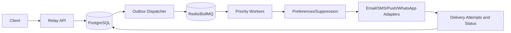
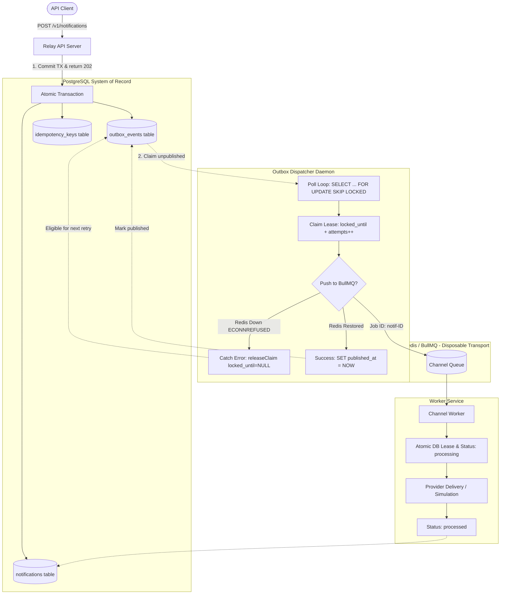
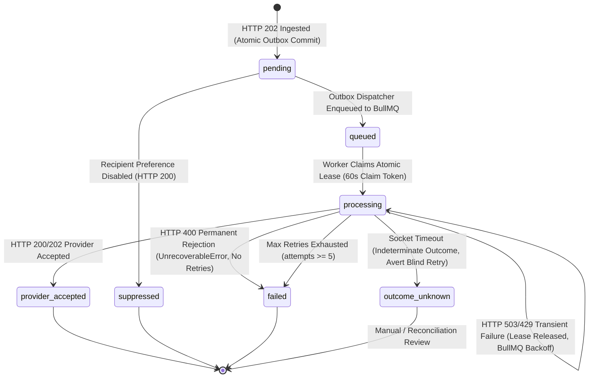
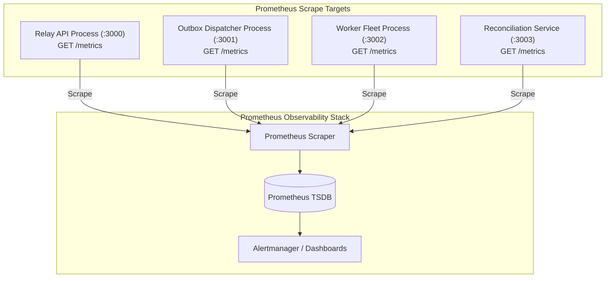
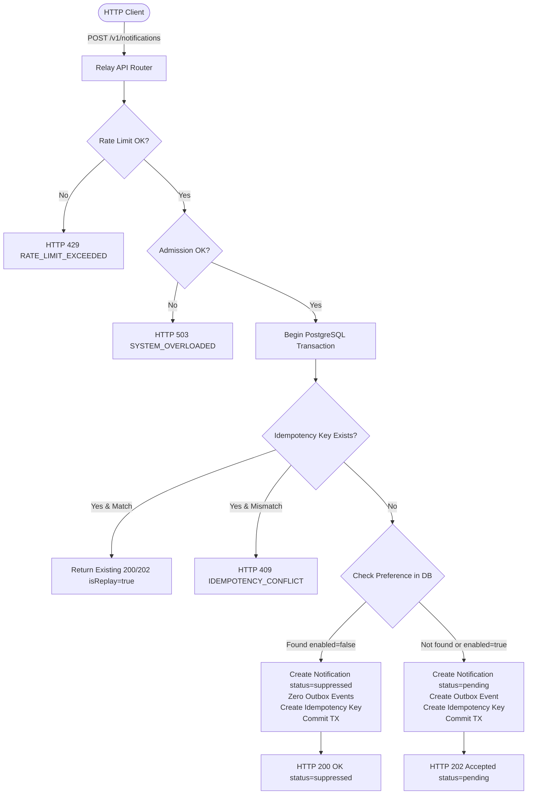

# Relay — System Design

**Design v0.1 · 27 October 2026 · Pre-implementation**

Designed for the Dev and Design HQ graduation Part 3. Estimates and vendor limits below are assumptions, not measured performance or verified vendor prices.

## 1. Requirements

Functional: async single notifications and campaigns; preferences, quiet hours, suppressions, status, retries, deduplication; production channels email/SMS/push/WhatsApp. Nonfunctional: 50M/day, tenant isolation, bursts, priority, audit, resilience. Prototype scope: Express/TypeScript, PostgreSQL, Redis/BullMQ, simulated email+SMS, failure injection and k6. Real-provider and 50M/day performance are NOT prototype claims.

## 2. Capacity estimates

50M/86400 = 579 notifications/s average. Assume 10× peak = 5,787/s. Example mix: push 60%, email 25%, SMS 10%, WhatsApp 5% (assumptions). Illustrative provider caps: push 2000/s, email 1000/s, SMS 200/s, WhatsApp 100/s. SMS cap = 17.28M/day. If ingress is 800 SMS/s and provider allows 200/s, backlog rises 600/s = 2.16M/hour. Estimate 150–200 bytes/notification base row, excluding indexes, WAL, payloads, attempts; verify by measurement.

## 3. API

TLS and bearer API key; store hashed secrets; key resolves tenant, scopes and environment. Never trust client-supplied customer_id. All reads/writes scoped to authenticated customer; cross-tenant resources return 404.
- POST /v1/notifications -> 202 + ID, Location; required Idempotency-Key.
- GET /v1/notifications/:id -> 200 + public status (Architectural contract specification; marked as future scope for API router, verified in prototype via PostgreSQL and tests).
- POST /v1/campaigns -> 202; required idempotency key; audience upload reference.
- GET /v1/campaigns/:id -> 200 + progress and counts_as_of.
- PATCH /v1/recipients/:id/preferences -> 200; If-Match for sensitive updates.
- GET /v1/health -> 200.
Errors: 400 validation, 401 authentication, 403 scope, 404 absent/cross-tenant, 409 idempotency conflict, 412 stale version, 428 missing precondition, 429 quota, 503 unavailable. Use Retry-After when applicable. Atomic transaction for notification+outbox+idempotency row. Same key and fingerprint replay original response; changed payload -> 409. Accepted != delivered.

## 4. Data model

Production candidate tables: customers, api_keys, recipients, device_tokens, recipient_preferences, suppressions, campaigns, campaign_recipients, notifications, notification_payloads, delivery_attempts, outbox_events, idempotency_keys, delivery_stats_daily. Notification has id, created_at, customer_id, campaign_id?, recipient_id, channel, type, priority, status, expiry, lease, retry count and provider reference. Delivery attempts append-only; outbox rows store publication state. Unique campaign_id+recipient_id prevents duplicate audience members.
Selective indexes: tenant+ID, campaign+ID, partial unpublished outbox, partial expired leases, attempts by notification. Partition by created_at at scale; PostgreSQL partitioned unique/PK includes partition key (e.g. id, created_at). ID-only lookup requires time-aware routing or directory. Partial-index predicate changes can prevent HOT updates. Benchmark before sharding.

Prototype database migrations ([`src/database/migrations/`](file:///c:/Users/HP/Desktop/relay-system/src/database/migrations)):
- `001_initial.sql`: Baseline schema (`customers`, `notifications`, `outbox_events`, `idempotency_keys`).
- `002_outbox_improvements.sql`: Outbox claiming and lease recovery columns (`claimed_at`, `attempts`, `locked_until`).
- `003_worker_leases.sql`: Worker atomic lease columns (`processing_started_at`, `processing_locked_until`, `claim_token`).
- `004_outbox_failure_handling.sql`: Terminal failure columns on `outbox_events` (`failed_at`, `failure_reason`, `last_error`).
- `005_notification_lifecycle.sql`: Extended lifecycle constraint adding `'processed'` to `notifications_status_check`.
- `006_notification_preferences.sql`: Recipient preferences table (`recipient_preferences`) and status check expansion adding `'suppressed'`.

## 5. Architecture diagram


Campaign manifest -> bounded expander -> notifications+outbox; status API reads PostgreSQL. Redis is disposable delivery infrastructure, not source of truth.

## 6. Deep dive: durability

Within one PostgreSQL transaction, write notification, idempotency record and outbox event, then return 202. Dispatcher claims outbox rows via FOR UPDATE SKIP LOCKED, enqueues stable IDs and marks published. Redis outage leaves rows durable. Publish succeeds but acknowledgement lost -> duplicate queue job possible. Workers claim atomically and record attempts; never promise universal exactly-once external sends.

### 6.1 Redis Failure Handling and Recovery Architecture



#### 1. Ingestion Isolation and Queue Decoupling
- **Decoupled Ingress:** The client request ingress path (`POST /v1/notifications`) communicates solely with PostgreSQL. It does not establish network connections or enqueue directly to Redis.
- **Atomicity:** The `notifications` record (status: `'pending'`), the `outbox_events` row (`event_type: 'notification.created'`), and the `idempotency_keys` record are committed together in a single PostgreSQL transaction before the API returns `202 Accepted`.
- **Fault Isolation:** Total loss of Redis (e.g., port unreachable, daemon down, network partition) has zero impact on ingress throughput or message durability.

#### 2. Outbox Dispatcher Claiming & Lease Protocol
- **Non-blocking Polling:** The background dispatcher daemon polls `outbox_events` periodically (default: 1000ms) using PostgreSQL row-level locks:
  ```sql
  SELECT id FROM outbox_events
  WHERE published_at IS NULL
    AND (locked_until IS NULL OR locked_until < NOW())
  ORDER BY created_at ASC
  FOR UPDATE SKIP LOCKED
  LIMIT 10;
  ```
- **Concurrency & Leases:** Claimed events have their `attempts` counter incremented and `locked_until` set to `NOW() + leaseDurationSeconds` (default: 60s) along with a unique `claim_token`. Multiple dispatcher instances can run concurrently without race conditions or double claims.

#### 3. Error Trapping and Dynamic Lease Release
- **Connection Error Handling:** The dispatcher utilizes `ioredis` configured with `maxRetriesPerRequest: null` (required by BullMQ) and event logging.
- **Immediate Lease Reset:** When `queue.add()` fails due to an unreachable Redis host (`ECONNREFUSED` or timeout), the dispatcher traps the exception in its retry loop and executes:
  ```sql
  UPDATE outbox_events
  SET locked_until = NULL
  WHERE id = $1 AND published_at IS NULL AND failed_at IS NULL;
  ```
- **Zero-Stall Recovery:** By explicitly resetting `locked_until` to `NULL` upon failure instead of waiting for the 60-second lease to expire, events become immediately eligible for re-dispatch as soon as Redis connectivity is re-established.

#### 4. Reconnection & At-Least-Once Publication
- **Automatic Reconnection:** `ioredis` automatically handles reconnection backoff in the background without requiring application restarts.
- **Deterministic Deduplication:** Jobs are enqueued into BullMQ using deterministic job IDs: `jobId = "notif-" + notification.id`. If a publication succeeds in Redis but the database acknowledgement fails, subsequent dispatcher attempts will be deduplicated by BullMQ, preserving at-least-once transport guarantees while preventing duplicate execution.
- **Publication Commit:** Upon verified queue acknowledgment, the dispatcher sets `published_at = NOW()`, clears leases, and conditionally updates `notifications.status` from `'pending'` to `'queued'`.

#### 5. Worker Atomic Claim & Lifecycle Transitions
- **Worker Leases:** BullMQ workers consume jobs and acquire an atomic lease on the `notifications` table (`processing_started_at`, `processing_locked_until = NOW() + 60s`, `claim_token`).
- **Valid Status Graph:** Notifications progress from `pending` -> `queued` -> `processing` -> `processed` (internal completion) or provider delivery statuses (`provider_accepted`, `delivered`, `failed`, `outcome_unknown`). Workers discard duplicate jobs if the row is already `processed` or being processed by an active lease.

#### 6. Terminal Failure Handling & Dead-Lettering
- **Threshold Limit:** If an outbox event encounters persistent errors and exceeds `maxAttempts` (default: 10), it is marked terminal:
  ```sql
  UPDATE outbox_events
  SET failed_at = NOW(), failure_reason = $2, locked_until = NULL, last_error = $2
  WHERE id = $1 AND published_at IS NULL AND failed_at IS NULL;
  ```
- **Auditable Safety:** Terminally failed outbox records are excluded from active polling (`idx_outbox_exhausted`), preventing poison-pill blocking while preserving complete forensic audit trails in PostgreSQL.

## 7. Deep dive: provider uncertainty and failure handling (Milestone 7B)

### 7.1 Architecture Overview
External communications providers (e.g., SendGrid, AWS SES, Twilio, Sinch) operate across public networks and introduce inherent operational uncertainties: transient outages (HTTP 503), tenant quota exhaustion (HTTP 429), unroutable destinations (HTTP 400), and socket timeouts (HTTP 504).

Relay addresses provider uncertainty through an decoupled adapter layer ([`src/adapters/simulatedProvider.ts`](file:///c:/Users/HP/Desktop/relay-system/src/adapters/simulatedProvider.ts)), bounded exponential queue retries via BullMQ, PostgreSQL lease safety, and a strict notification lifecycle state machine.



### 7.2 Provider Failure Taxonomy & Worker Execution Policies

| Failure Mode | HTTP Status | Retryable | DB Transition | BullMQ Worker Action | Justification |
| :--- | :--- | :--- | :--- | :--- | :--- |
| **Successful Acceptance** | `202 Accepted` / `200 OK` | N/A | `processing` → `provider_accepted` | Record metrics, clear lease, complete job | Provider confirmed receipt; message handed off to carrier/MTA. |
| **Temporary Provider Outage** | `503 Service Unavailable` | Yes | Lease released (`processing_locked_until = NULL`, `retry_count++`) | Throw `ProviderError` for exponential backoff | Downstream gateway experiencing transient disruption; safe to retry after cooldown. |
| **Provider Rate Limiting** | `429 Too Many Requests` | Yes | Lease released (`processing_locked_until = NULL`, `retry_count++`) | Throw `ProviderError` for exponential backoff | Account dispatch quota exceeded; backoff prevents cascading provider bans. |
| **Network Socket Timeout** | `504 Gateway Timeout` | Indeterminate | `processing` → `outcome_unknown` | Throw `UnrecoverableError` to abort blind retries | Request dispatched over network but socket severed before ACK; duplicate send could double-deliver. |
| **Permanent Client/Payload Rejection** | `400 Bad Request` | No | `processing` → `failed` | Throw `UnrecoverableError` immediately | Invalid destination address, unroutable prefix, or schema error; retrying will never succeed. |
| **Retry Limit Exhaustion** | Any | No | `processing` → `failed` | Throw error to fail BullMQ job | Exceeded maximum configured attempts (`job.opts.attempts = 5`); prevents infinite queue loops. |

### 7.3 Lease Protocol & Idempotency Invariants
1. **Atomic Claim Token:** Before invoking the provider adapter, workers claim the notification in PostgreSQL using a timed lease:
   ```sql
   UPDATE notifications
   SET status = 'processing',
       processing_started_at = COALESCE(processing_started_at, NOW()),
       processing_locked_until = NOW() + INTERVAL '60 seconds',
       claim_token = $3,
       updated_at = NOW()
   WHERE id = $1
     AND (status IN ('pending', 'queued') OR (status = 'processing' AND (processing_locked_until IS NULL OR processing_locked_until < NOW())))
     AND (processing_locked_until IS NULL OR processing_locked_until < NOW() OR claim_token IS NULL)
   RETURNING *;
   ```
2. **Dynamic Lease Release on Backoff:** During transient 503 or 429 failures, the worker explicitly clears `processing_locked_until = NULL` and `claim_token = NULL` before throwing the error. When BullMQ's exponential delay fires (e.g. 2s, 4s, 8s), the subsequent attempt re-claims the notification cleanly.
3. **Defense Against Duplicate Provider Calls:** If a delayed or duplicate BullMQ job executes for a notification already in a terminal state (`provider_accepted`, `processed`, `failed`, `outcome_unknown`, `suppressed`), the worker detects the terminal status upon row claim inspection and skips execution immediately without invoking the external provider adapter.
4. **Preference Suppression Integration:** If a recipient has opted out of a channel (`recipient_preferences.enabled = false`), the API marks the notification `status: 'suppressed'` at ingestion and creates zero outbox events, guaranteeing that suppressed requests never reach Redis queues, workers, or provider adapters.

## 8. Deep dive: queues, fairness, backpressure

Production channel×priority lanes, e.g. sms.critical, sms.transactional, sms.bulk. Shared provider-account Redis token bucket; do not limit per worker independently. Bulk fails closed if limiter unavailable; emergency critical allowance strictly bounded. Weighted fair tenant scheduling and paced campaign expansion. Bulk may borrow idle capacity but critical traffic preempts it. Backlog remains in PostgreSQL/unexpanded manifests; Redis work window bounded. Sustained overload needs admission control, expiry, capacity purchase or additional providers, not merely more workers.

## 9. Design patterns

Transactional Outbox (durable DB-to-queue), Adapter (provider interface), Strategy (retry policy), Repository (tenant-scoped persistence), Circuit Breaker (provider outage), Exponential Backoff (temporary errors), State Machine (valid status transitions). Implement and test at least three in prototype; design listing is not implementation evidence.

## 10. Scaling, caching, replication, sharding

1k users: one API, PostgreSQL, Redis, workers. 100k: scale stateless API/workers, connection pool, partitions, metrics, provider quotas. 10m: tenant logical shards, dedicated hot tenants, analytics pipeline, multiple providers. Defer sharding until measured bottlenecks. Candidate shard key customer_id, with time partitions inside shards. Preference cache requires invalidation and safe opt-out handling. Read replicas for eventually consistent status/analytics, primary for idempotency and claims. Proposed retention: hot 14 days, warm to 90, archive as required; legal/customer policies override; minimize PII.

## 11. Failure modes

Redis outage -> outbox retry; dispatcher crash after enqueue -> dedup/claim; worker crash before send -> lease recovery; crash after provider send -> outcome_unknown; provider timeout -> reconcile; provider 429 -> Retry-After; provider outage -> circuit breaker/fallback; PostgreSQL outage -> 503 no false acceptance; opt-out mid-queue -> suppress at send; expander crash -> cursor resume; poison job -> DLQ; duplicate API request -> replay; expired worker lease -> fencing/version; backlog -> expiry/admission control; late callback -> reconcile. Drill: stop Redis, accept jobs into Postgres, restart Redis, verify recovery; inject provider timeout and capture logs.

### 11.1 Validated Outage Drill: Redis Failure & Auto-Recovery (Oct 28, 2026)
- **Failure Condition:** Redis unavailable with `ECONNREFUSED` on port 6386 during notification ingestion.
- **Observed Ingress Behavior:** API accepted request `16abf08c-837b-4b50-86ae-c327e7795f5d` at `11:07:05 UTC`, returning `202 Accepted`. Database committed transaction atomically.
- **Recovery Path:** Upon Redis reconnection, Dispatcher claimed the pending row, published to `sms-notifications` queue at `11:08:01 UTC` (recovery interval: ~55.4s), and SMS worker processed the job to `processed` status.
- **Operational Findings:** Outbox lease releasing on connection errors prevents artificial delays; deterministic BullMQ job IDs prevent duplicate delivery risks. Verified that zero messages are lost when Redis fails entirely.
- **Operational Limitation:** Intermediate pending/unpublished state was not sampled via independent database snapshot during the downtime interval itself; operational procedures must ensure mid-outage telemetry capture in future drills.

## 12. Tradeoffs, costs and validation

Tradeoffs: outbox reliability vs writes; at-least-once vs duplicate risk; priority queues vs complexity; gradual expansion vs campaign latency; partition retention vs global uniqueness; tenant sharding vs routing overhead; fake providers vs real-world fidelity.

### 12.3 Monthly Infrastructure Cost Model (100,000 Users — Milestone 7D)
Relay's monthly operating costs were rigorously modeled for a deployment of **100,000 registered end-user recipients** across 100 business tenants, using official provider pricing pages verified on **30 October 2026** ([`benchmarks/COST-MODEL.md`](file:///c:/Users/HP/Desktop/relay-system/benchmarks/COST-MODEL.md)).

#### Workload Dimensions & Assumptions
- **User Population:** 100,000 registered recipients in `recipient_preferences`.
- **Storage & Retention:** Rolling 30-day live database window (~2.0 KB per notification transaction across `notifications`, `outbox_events`, `idempotency_keys`, and B-Tree indexes).
- **Transport Buffer:** Transitory Redis queue buffer (< 100 MB active footprint).
- **Channel Partition:** Multi-channel distribution spanning Email and SMS.

#### Verified Official Provider Pricing (Checked 30 October 2026)
- **API Compute:** Render Web Service Standard (1 vCPU, 2 GB RAM) — **$25.00 / month** ([render.com/pricing](https://render.com/pricing)).
- **Worker Fleet:** Render Background Worker Standard (1 vCPU, 2 GB RAM) — **$25.00 / month** ([render.com/pricing](https://render.com/pricing)).
- **PostgreSQL Database:** Neon Serverless PostgreSQL Launch Plan — **$0.106 / CU-hour** compute, **$0.35 / GB-month** storage ([neon.tech/pricing](https://neon.tech/pricing)).
- **Redis Queue / Cache:** Render Key Value Standard (1 GB RAM, disk persistence) — **$20.00 / month** ([render.com/pricing](https://render.com/pricing)).
- **Email Delivery:** Amazon SES Outbound — **$0.10 per 1,000 emails** ($0.0001/email) ([aws.amazon.com/ses/pricing](https://aws.amazon.com/ses/pricing/)).
- **SMS Delivery:** Twilio US Outbound — **$0.0125 per segment** ($0.0083 base + ~$0.0042 carrier pass-through) + **$1.15/mo** 10DLC number + **$1.50/mo** campaign fee ([twilio.com/en-us/sms/pricing/us](https://www.twilio.com/en-us/sms/pricing/us)).
- **Observability:** Grafana Cloud Pro Tier — **$19.00 / month** base + $0.45/GB logs ([grafana.com/pricing](https://grafana.com/pricing/)).
- **Database Backups:** Amazon S3 Standard — **$0.023 / GB-month** ([aws.amazon.com/s3/pricing](https://aws.amazon.com/s3/pricing/)).

#### Three Monthly Cost Scenarios (100,000 Users)
| Scenario | Active Ratio (MAU) | Monthly Volume | Channel Mix (Email / SMS) | Server Infra | Third-Party Telecom | Total Monthly Cost | Cost / 1k Notifs |
| :--- | :--- | :--- | :--- | :--- | :--- | :--- | :--- |
| **Scenario A (Low)** | 30% (30k MAU) | 60,000 / mo (2/user) | 85% Email / 15% SMS | $43.38 | $120.25 | **$163.63** | **$2.73** |
| **Scenario B (Expected)** | 60% (60k MAU) | 300,000 / mo (5/user) | 80% Email / 20% SMS | $136.19 | $776.65 | **$912.84** | **$3.04** |
| **Scenario C (High)** | 85% (85k MAU) | 1,700,000 / mo (20/user) | 75% Email / 25% SMS | $369.46 | $5,452.30 | **$5,821.76** | **$3.42** |

*(Note on Classification: Under a strict fixed baseline subscription vs. volume-variable consumption model, Scenario B divides into **$130.69 fixed subscriptions** [compute, baseline DB, Redis, Grafana base, phone numbers, 10DLC campaign] and **$782.15 variable usage** [SES emails, SMS segments, storage, logs, egress], totaling **$912.84**).*

#### Critical Cost Takeaways & Capacity Sufficiency
1. **SMS Dominance:** Telecommunications carrier fees for SMS dwarf compute infrastructure, accounting for **85.1%** of monthly expenditure in Scenario B ($776.65 of $912.84) and **93.7%** in Scenario C. Sending 1,000 SMS ($12.50) is **125x more expensive** than sending 1,000 emails ($0.10 via SES).
2. **Safeguard Value:** This disparity proves that **Tenant Rate Limiting (Milestone 6B)** and **Recipient Preference Suppression (Milestone 7A)** are vital financial controls that protect tenant budgets from runaway billing.
3. **Capacity Sufficiency:** Based on empirical Milestone 7C benchmarks (where Relay sustained 1.70 req/s baseline against remote Neon), single-instance configurations are fully sufficient for Scenarios A (0.23 req/s peak) and B (1.16 req/s peak). Scenario C (6.56 req/s peak) exceeds single-node connection pool capacity and requires 2 horizontal API pods and connection pooling (PgBouncer); this multi-node topology is mathematically budgeted but has not been tested in the single-node prototype.
4. **100k Users vs. 50M/Day Target:** Conflating this 100k-user model ($912/mo for 300k notifs) with the 50M/day target (1.5B notifs/mo) is invalid. The 50M/day design target is 5,000x larger in volume and requires a fundamentally different architecture: multi-tenant PostgreSQL sharding, distributed streaming brokers (Kafka/Pulsar), and enterprise aggregator agreements.

### 12.1 Empirical k6 Load Testing (Milestone 7C)
Relay was evaluated using Grafana k6 v0.54.0 against the live API, remote Neon cloud PostgreSQL, and local Redis across three controlled traffic profiles ([`benchmarks/k6/REPORT.md`](file:///c:/Users/HP/Desktop/relay-system/benchmarks/k6/REPORT.md)):

| Profile | Concurrency | Total Req | Total HTTP Throughput | Accepted Throughput | Latency p50 (All / Accepted) | Latency p95 (All / Accepted) | Ingress Outcomes |
| :--- | :--- | :--- | :--- | :--- | :--- | :--- | :--- |
| **Scenario A: Baseline** | 3 VUs (20s) | 36 | 1.70 req/s | 1.70 accepted/s | 1,156 ms / 1,156 ms | 2,759 ms / 2,762 ms | 36 Accepted (HTTP 202, 100.0%), 0 errors |
| **Scenario B: Gradual Ramp-Up** | 2 → 35 VUs (50s) | 1,490 | 28.33 req/s | 4.13 accepted/s | 3.91 ms / 1,448 ms | 2,335 ms / 3,059 ms | 217 Accepted (202), 17 Suppressed (200), 890 Rate-Limited (429), 352 Overload Defense (503), 14 client timeouts (0.94%) |
| **Scenario C: Short Spike** | 5 → 30 VUs (30s) | 727 | 23.34 req/s | 3.30 accepted/s | 204 ms / 1,227 ms | 1,315 ms / 2,151 ms | 103 Accepted (202), 9 Suppressed (200), 615 Overload Defense (503), 0 crashes |

### 12.2 Architectural Analysis: Prototype vs. 50M/Day Target
- **Design Target:** 50,000,000 notifications / day = **579 req/s sustained**, **5,787 req/s peak (10x)**.
- **Measured Prototype Throughput:** Peak total HTTP throughput of **28.33 req/s** (evaluating fast defenses); measured sustained durable acceptance of **3.30–4.13 accepted notifications/s** under multi-VU concurrency.
- **Explanation of Gap:**
  1. *Remote Cloud Database Latency:* The prototype connects to an AWS Neon PostgreSQL instance in London over public TLS. Each transaction involves 4 round-trips (`BEGIN` → `SELECT customer & idempotency` → `INSERT notification, outbox, idempotency` → `COMMIT`). Network RTT (~80–150ms per round-trip from the local client) sets an unavoidable physical floor of ~1,000–1,400ms per database transaction.
  2. *Connection Pool Sizing & Theoretical Ceiling:* The prototype connection pool is configured to `DB_POOL_MAX = 15` ([`src/config/env.ts`](file:///c:/Users/HP/Desktop/relay-system/src/config/env.ts)) to stay safely within Neon serverless free-tier concurrency limits. Under single-node operation:
     $$\text{Theoretical Ingress Ceiling (Estimate)} = \frac{15 \text{ connections}}{1.0\text{–}1.4 \text{ s/transaction}} \approx 10.7\text{–}15.0 \text{ req/s}$$
     Under multi-VU concurrency, connection checkout serialization, lock contention, and worker background operations reduce measured sustained acceptance throughput to **3.30–4.13 accepted/sec**.
  3. *Single Node Topology:* The prototype runs a single Express Node.js process and a single PostgreSQL primary without read replicas, horizontal API pods, or connection multiplexers (e.g. PgBouncer).
- **Protection Validation:** Under saturation (35 VUs in Ramp-Up, 30 VUs in Spike), Relay's defensive mechanisms operated flawlessly:
  - Redis Lua rate limiting rejected excess tenant traffic in **3.91 ms (p50)**, protecting PostgreSQL from unnecessary queries.
  - Backpressure admission control rejected overload traffic in **< 10 ms** with `HTTP 503 SYSTEM_OVERLOADED` and `Retry-After: 5`, preventing database pool starvation or unhandled 500 crashes.
  - During maximum contention at 35 VUs, 14 requests experienced client-side TCP timeouts (15s k6 timeout) in the pool checkout queue; zero server crashes or 500 errors occurred.
  - Upon load reduction, the system recovered within 1.5 seconds without administrator intervention.

## 13. Observability & Operational Metrics Architecture

### 13.1 Architecture Overview
Relay implements Prometheus-compatible metrics exposition using `prom-client` across all system components. Metrics are structured to observe throughput, failure rates, queue backlog, worker latency, and lifecycle transitions without introducing runtime overhead or security vulnerabilities.



### 13.2 Multi-Process Telemetry Across Daemons
Relay executes its core services as independent Node.js processes. Metrics collected in process memory are isolated to that runtime:
1. **Per-Process HTTP Metrics Endpoints:** Background daemons (dispatcher, workers, reconciliation) can expose dedicated metrics endpoints via `startProcessMetricsServer` on configured ports (`DISPATCHER_METRICS_PORT`, `WORKERS_METRICS_PORT`, `RECONCILIATION_METRICS_PORT`). This allows containerized orchestrators (e.g. Kubernetes) to scrape each pod/process independently.
2. **Dynamic System Gauges on Primary API:** The API's `GET /metrics` dynamically samples system-wide state on scrape:
   - Outbox backlog count: `SELECT COUNT(*) FROM outbox_events WHERE published_at IS NULL AND failed_at IS NULL`.
   - BullMQ queue state: `getJobCounts('waiting', 'active', 'delayed', 'failed', 'completed')` across `email` and `sms` queues when Redis is connected.
   This provides single-endpoint observability for development and lightweight environments.

### 13.3 Metrics Catalogue

| Component | Metric Name | Type | Labels | Description |
| :--- | :--- | :--- | :--- | :--- |
| **API** | `relay_api_requests_total` | Counter | `method`, `route`, `status_code` | Total HTTP requests handled |
| **API** | `relay_api_request_duration_seconds` | Histogram | `method`, `route`, `status_code` | HTTP request latency (buckets: 5ms to 10s) |
| **API** | `relay_api_validation_failures_total` | Counter | (none) | Total validation rejections (HTTP 400) |
| **API** | `relay_api_idempotency_conflicts_total` | Counter | (none) | Total idempotency payload conflicts (HTTP 409) |
| **API** | `relay_api_rate_limits_total` | Counter | (none) | Total rate limit rejections (HTTP 429) |
| **Lifecycle** | `relay_notifications_status_total` | Counter | `status`, `channel` | Notification transitions (`accepted`, `queued`, `processing`, `processed`, `failed`, `outcome_unknown`) |
| **Dispatcher**| `relay_dispatcher_outbox_awaiting_publication` | Gauge | (none) | Unpublished outbox events waiting in PostgreSQL |
| **Dispatcher**| `relay_dispatcher_publications_total` | Counter | `channel`, `status` | Outbox queue publication attempts (`success`, `failure`) |
| **Dispatcher**| `relay_dispatcher_publication_duration_seconds` | Histogram | `channel` | Outbox-to-queue publication latency |
| **Dispatcher**| `relay_dispatcher_outbox_retries_total` | Counter | `channel` | Re-dispatched outbox events |
| **Workers** | `relay_worker_jobs_total` | Counter | `channel`, `status` | Worker job outcomes (`processed`, `failed`, `skipped`) |
| **Workers** | `relay_worker_job_duration_seconds` | Histogram | `channel` | Processing execution latency (buckets: 10ms to 30s) |
| **Workers** | `relay_worker_retries_total` | Counter | `channel` | Job retry attempts |
| **Workers** | `relay_worker_active_jobs` | Gauge | `channel` | Currently executing jobs |
| **Queue** | `relay_queue_jobs_waiting` | Gauge | `channel` | Jobs waiting in BullMQ |
| **Queue** | `relay_queue_jobs_active` | Gauge | `channel` | Jobs active in BullMQ |
| **Queue** | `relay_queue_jobs_delayed` | Gauge | `channel` | Jobs delayed in BullMQ |
| **Queue** | `relay_queue_jobs_failed` | Gauge | `channel` | Failed jobs in BullMQ |
| **Queue** | `relay_queue_jobs_completed` | Gauge | `channel` | Completed jobs in BullMQ |
| **Reconciler**| `relay_reconciliation_expired_leases_total` | Counter | `channel` | Stuck processing leases detected |
| **Reconciler**| `relay_reconciliation_recovered_total` | Counter | `channel` | Notifications reconciled/unlocked |
| **Reconciler**| `relay_reconciliation_failures_total` | Counter | `channel` | Reconciliation processing errors |
| **Redis** | `relay_redis_connected` | Gauge | (none) | Connection state (1 = connected, 0 = disconnected) |
| **Redis** | `relay_redis_disconnects_total` | Counter | (none) | Total connection drops |
| **Redis** | `relay_redis_reconnects_total` | Counter | (none) | Total successful reconnections |
| **Redis** | `relay_redis_connection_errors_total` | Counter | (none) | Total connection errors |
| **Redis** | `relay_redis_consecutive_failures` | Gauge | (none) | Current consecutive connection failures |

### 13.4 Metric Label Safety & Cardinality Control
- **Strict Bounding:** Metric labels are constrained to low-cardinality static sets.
- **Forbidden Labels:** Notification UUIDs, recipient phone numbers, email addresses, idempotency keys, and tenant/customer UUIDs are strictly disallowed as Prometheus labels to eliminate cardinality explosion attacks and protect PII.
- **Route Normalization:** Paths are processed through `normalizeRoute()`, replacing arbitrary path parameters (e.g. `/v1/notifications/<uuid>`) with static patterns (`/v1/notifications/:id`) and mapping unknown URLs to `"unknown"`.

### 13.5 Health and Readiness Architecture
- **Liveness (`GET /v1/health`):** Verifies the process is alive and responsive. Returns HTTP 200 without issuing external dependency queries.
- **Readiness (`GET /v1/ready`):** Evaluates whether the API can perform durable ingestion.
  - Because notifications are accepted atomically into PostgreSQL (`notifications` + `outbox_events`) before queuing to Redis, **Redis downtime does not make the API unready**.
  - If PostgreSQL is healthy: Returns `HTTP 200 OK` (`status: "ready"`, `dependencies.database: "healthy"`), noting Redis as degraded if unavailable.
  - If PostgreSQL fails: Returns `HTTP 503 Service Unavailable` (`status: "not_ready"`, `dependencies.database: "unhealthy"`).

### 13.6 Redis Connection Resilience & Log Throttling
- **Bounded Backoff with Jitter:** Configured `ioredis.retryStrategy` using exponential backoff with ±20% randomized jitter:
  $$\text{delay} = \min(\text{times} \times 200\text{ ms}, 5000\text{ ms}) \pm \text{jitter}$$
- **Log Throttling:** During prolonged Redis outages, repeated connection errors are throttled (logged on failure 1, 5, 25, and every 30s) to prevent log-disk exhaustion. Reconnection logs total consecutive failures upon recovery.

### 13.7 Supporting 50-Million-Per-Day Target Capacity
- **Design Target:** 50M notifications/day requires 579/s sustained throughput and 5,787/s peak capacity.
- **Bottleneck Detection:**
  - `relay_api_request_duration_seconds` detects API saturation under peak ingress.
  - `relay_dispatcher_outbox_awaiting_publication` and publication duration histograms detect dispatcher backlog formation.
  - `relay_queue_jobs_waiting` and `relay_worker_active_jobs` detect worker pool exhaustion.
- **Non-claim:** The prototype implements the metrics architecture necessary to measure this scale; it has **not** demonstrated 50-million-per-day throughput in prototype benchmarks.

### 13.8 Production Security for /metrics
In production deployments:
1. **Network Isolation:** Restrict `/metrics` to internal management subnets or private VPCs.
2. **Reverse Proxy Rules:** Strip or block public access to `/metrics` via NGINX/Cloudflare/Envoy routing rules.
3. **Authentication:** Require mTLS, basic authentication, or internal bearer tokens via reverse proxy middleware before exposing metrics.

---

## 14. Tenant Rate Limiting Architecture (Milestone 6B)

### 14.1 Objective & Principles
Relay implements multi-tenant sliding window rate limiting on `POST /v1/notifications` to prevent individual tenants from overwhelming API ingress, PostgreSQL connection pools, and downstream delivery queues.

Key principles:
1. **Tenant Isolation:** Quotas are enforced strictly per-tenant; saturation or exhaustion by Tenant A has zero impact on Tenant B.
2. **Durable Ingestion Preservation (Fail-Open):** Redis is used for high-performance shared rate limiting, but Redis downtime must never compromise Relay's core architectural guarantee: durable acceptance of notifications into PostgreSQL.
3. **Atomic State Sharing:** All distributed API instances share identical rate-limit state in Redis without race conditions.
4. **Idempotency Protection:** Safe idempotency replays do not penalize tenant quota, while malicious replay floods cannot bypass database defenses.

```mermaid
flowchart TD
    Client["Client Request (POST /v1/notifications)"] --> ExtractTenant["Validate Body & Extract customerId"]
    ExtractTenant --> RLCheck{"RateLimiter.consume(customerId)"}

    subgraph RedisEvaluation["Atomic Redis Lua (Sliding Window Log)"]
        RLCheck -->|Redis Available| LuaScript["Lua Script: ZREMRANGEBYSCORE + ZCARD + ZADD"]
        RLCheck -->|Timeout / Redis Error| FailOpen["Fail-Open (Log throttled warning & record metric)"]
    end

    FailOpen --> AllowIngress["Allow Durable Ingestion"]
    LuaScript -->|current >= limit| Return429["Return HTTP 429 Too Many Requests\n(RateLimit-* and Retry-After headers)"]
    LuaScript -->|current < limit| AllowIngress

    AllowIngress --> DBTx["PostgreSQL Transaction (notifications + outbox_events)"]
    DBTx --> ReplayCheck{"Is Safe Idempotent Replay?"}
    ReplayCheck -->|Yes (Identical Payload)| RefundToken["RateLimiter.refund(member)\n(ZREM member from Redis ZSET)"]
    ReplayCheck -->|No (New Notification)| Ret202["Return HTTP 202 Accepted"]
    RefundToken --> Ret202
```

### 14.2 Tenant Identity & Security Boundaries
In the current prototype, tenant identity is derived from `customerId` supplied in the JSON request body (validated by `NotificationRequestSchema`).

> [!CAUTION]
> **Production Authentication Boundary:** In production environments, client-supplied body attributes like `customerId` must **never** be trusted for rate limiting or tenant authorization. Production deployments must derive tenant identity from cryptographically verified credentials:
> - Mutual TLS (mTLS) client certificate subjects.
> - Cryptographically signed JWT claims (e.g. `sub` or `tenant_id`).
> - Secure API Keys hashed and authenticated in an ingress API gateway.
> The prototype preserves the body-supplied `customerId` strictly for compatibility with earlier milestones without introducing out-of-scope authentication frameworks.

### 14.3 Atomic Sliding Window Log Algorithm via Redis Lua
Fixed-window counters suffer from "boundary burst" vulnerabilities where a client can send $2 \times \text{limit}$ requests across the window boundary (e.g. 100 requests at 11:59:59 and 100 requests at 12:00:01).

Relay implements a **Sliding Window Log** using a Redis Sorted Set (`ZSET`) executed entirely within an atomic Lua script:
- **Key Format:** `rl:tenant:{customerId}`.
- **Score:** Current Unix timestamp in milliseconds (`now`).
- **Member:** `${now}:${uuid}` (unique per request).

**Lua Script Operations:**
1. `ZREMRANGEBYSCORE key 0 (now - windowMs)`: Removes all elements timestamped outside the sliding window.
2. `ZCARD key`: Counts current requests within the active window.
3. If `current < limit`:
   - Adds the new request: `ZADD key now member`.
   - Refreshes TTL: `PEXPIRE key windowMs`.
   - Returns `{1, limit - current - 1, ceil(window / 1000)}`.
4. If `current >= limit`:
   - Queries oldest request score: `ZRANGE key 0 0 WITHSCORES`.
   - Computes reset latency: `resetMs = math.max(0, (oldestScore + window) - now)`.
   - Refreshes TTL: `PEXPIRE key windowMs`.
   - Returns `{0, 0, math.max(1, ceil(resetMs / 1000))}`.

**Automatic Key Expiration:** Every evaluation executes `PEXPIRE key windowMs`. If a tenant stops making requests, Redis automatically evicts the entire Sorted Set upon TTL expiration, guaranteeing zero memory leaks.

### 14.4 HTTP Contract & Standard Response Headers
Every ingestion request receives standard `RateLimit-*` headers matching IETF draft recommendations:

| Header | Description | Example |
| :--- | :--- | :--- |
| `RateLimit-Limit` | Configured tenant quota for the sliding window | `100` |
| `RateLimit-Remaining` | Remaining requests available in the current sliding window | `99` |
| `RateLimit-Reset` | Seconds until quota refreshes or oldest request rolls off | `60` |
| `Retry-After` | Included on HTTP 429 to specify seconds client must wait | `45` |

When a tenant exceeds its limit, the API immediately halts processing and returns `HTTP 429 Too Many Requests`:
```json
{
  "code": "RATE_LIMIT_EXCEEDED",
  "message": "Too many requests for tenant d600ffb8-91ac-46ec-8837-c8455c9ffe5b. Please retry after 45 seconds."
}
```

### 14.5 Idempotency and Rate Limit Interaction
Relay balances DDoS protection against idempotency fairness:
1. **Pre-Execution Quota Consumption:** The rate limit is evaluated and consumed *before* interacting with PostgreSQL. This protects the database connection pool, row locks, and disk I/O from being flooded by high-frequency duplicate replay storms.
2. **Safe Identical Replay Refund:** If the database transaction reveals that the request is a safe identical idempotency match (`isReplay: true`, returning the existing record with HTTP 202), Relay invokes `rateLimiter.refund(customerId, member)` which executes `ZREM key member`. The client is not penalized for network retries or safe poll requests.
3. **Conflicting Replay Penalty:** If a request attempts to reuse an existing idempotency key with a differing payload (HTTP 409 Conflict), **no refund is issued**. Conflicting replays represent invalid client behavior that consumed server compute and must remain bounded by rate limits.

### 14.6 Redis Failure Policy: Fail-Open for Durable Acceptance
Relay's primary durability promise is that notifications are committed to PostgreSQL (`notifications` and `outbox_events`) inside a single ACID transaction before queueing to Redis.

Therefore, Redis unavailability must never block ingestion:
- **Fail-Open Policy:** If Redis is down, disconnected, or fails during script execution, the rate limiter catches the error and immediately fails open (`allowed: true, failOpen: true`), returning `HTTP 202 Accepted` and recording the notification in PostgreSQL.
- **Bounded Latency:** All Redis calls are protected by a strict timeout (`RATE_LIMIT_TIMEOUT_MS`, default 500ms) using `Promise.race()`. A slow or hung Redis connection cannot back up Express request handlers.
- **Log Throttling:** Warnings are throttled to at most one log every 30 seconds to prevent logging disk exhaustion during sustained Redis outages.
- **Metrics Tracking:** Every fail-open event increments `relay_rate_limit_redis_failures_total` and records `relay_rate_limit_evaluations_total{result="fail_open"}`.

### 14.7 Metrics Catalogue Additions

| Metric Name | Type | Labels | Description |
| :--- | :--- | :--- | :--- |
| `relay_rate_limit_evaluations_total` | Counter | `result` (`allowed`, `rate_limited`, `fail_open`) | Total rate limiter evaluations categorized by decision outcome |
| `relay_rate_limit_evaluation_duration_seconds` | Histogram | (none) | Latency in seconds taken to evaluate Redis Lua scripts (buckets: 0.5ms to 500ms) |
| `relay_rate_limit_redis_failures_total` | Counter | (none) | Total Redis connection drops or timeouts triggering fail-open behavior |

> [!IMPORTANT]
> **Label Safety:** In compliance with Prometheus best practices, tenant UUIDs (`customerId`) are strictly excluded from metric labels to prevent cardinality explosion across thousands of active tenants.

### 14.8 Capacity & Scaling to 50M/day Target Workload
- **Ingress Rate Context:** 50M notifications/day corresponds to ~579 requests/second average and ~5,787 requests/second peak across all tenants.
- **Redis Memory Overhead:** Each entry in a Redis Sorted Set consumes ~50 bytes. At the default limit of 100 requests/minute, an active tenant consumes $\approx 5\text{ KB}$ of Redis memory. For 10,000 concurrently active tenants, total Redis memory consumption is $\approx 50\text{ MB}$, well within standard single-node memory allocations.
- **Scale Trade-offs:** For ultra-high tenant scale (>100,000 tenants at 10,000 req/sec), sliding window log can be transitioned to a **Sliding Window Counter** (two integer keys per tenant with linear interpolation) or a **Token Bucket** (hash storing last refill timestamp and token count) to reduce memory from $O(N)$ requests to $O(1)$ constant memory per tenant.

---

## 15. Tenant-Aware Fair Scheduling

**Milestone 6C Architecture · October 2026**

### 15.1 Architectural Objectives & Constraints
In a multi-tenant notification system targeting 50 million notifications/day, tenants have wildly asymmetric ingestion profiles. Without fairness controls, a single high-volume tenant (e.g. bulk marketing blast of 100,000 notifications) monopolizes system capacity, imposing head-of-line (HoL) blocking on latency-critical transactional notifications (e.g. password resets, two-factor OTPs) from low-volume tenants.

Relay achieves tenant fairness subject to five core non-negotiable invariants:
1. **Zero Message Loss (Durability):** All notifications are durably committed to PostgreSQL before scheduling.
2. **At-Least-Once Delivery:** Scheduling decisions must never drop, cancel, or prematurely fail notifications.
3. **Work-Conserving Bursting:** When only one tenant has work pending, the system must not arbitrarily idle worker capacity; the sole tenant may burst up to 100% of cluster concurrency.
4. **Bounded Memory & Infrastructure Complexity:** No permanent Redis queue per tenant. State must be bounded, automatically expiring, and decoupled from total registered tenants.
5. **Multi-Instance Concurrency Safety:** Multiple Dispatchers and Workers must schedule fairly without inter-process coordination bottlenecks or split-brain claims.

```mermaid
flowchart TD
    subgraph Stage1 [Stage 1: Outbox Interleaved Round-Robin Claiming]
        direction TB
        PG[(PostgreSQL outbox_events)] -->|SQL Window Function\nROW_NUMBER PARTITION BY customer_id| IRR[Interleaved Dispatcher Query]
        IRR -->|Round-Robin Batch\nA1, B1, C1, A2, B2, C2...| Pub[Publish to Channel Queues]
    end

    subgraph Stage2 [Stage 2: Distributed Dynamic Tenant Concurrency Control]
        direction TB
        Pub --> BullMQ[(BullMQ Queue: email / sms)]
        BullMQ --> Worker[Channel Worker Process]
        Worker -->|Redis Lua acquireSlot| LuaCheck{Slot Check}
        LuaCheck -->|Active < Max (2)\nOR Sole Tenant Burst| Grant[Execute Job & Acquire Lease]
        LuaCheck -->|Contention & Quota Full| Defer[job.moveToDelayed 500ms\nDelayedError]
        Defer -->|Re-enters queue later| BullMQ
        Grant --> Deliver[Simulate Delivery & Update DB]
        Deliver --> Release[Redis Lua releaseSlot]
    end
```

### 15.2 Comparative Analysis of Fairness Algorithms

| Algorithm | Mechanism | Advantages | Disadvantages & Why Rejected for Single Stage |
| :--- | :--- | :--- | :--- |
| **Pure Global FIFO** | Single queue ordered by `created_at` | Trivial implementation; maximum raw throughput | **Severe Starvation:** High-volume tenant monopolizes queue for minutes/hours. Complete HoL blocking. |
| **One Queue Per Tenant (Multi-Queue RR)** | Dedicated BullMQ queue per customer ID | Strict isolation; independent throughput | **Unbounded Infrastructure:** Millions of queues in Redis; high idle polling CPU; memory bloat; dead queue management. |
| **Weighted Fair Queuing (WFQ)** | Virtual finish time calculation per packet | Mathematically ideal bandwidth distribution | Heavy bookkeeping state in distributed Redis; high latency on Redis round-trips; complex failure recovery. |
| **Deficit Round-Robin (DRR)** | Quantum & deficit counter per active tenant | Fair byte/message allocation with burst tolerance | High distributed state tracking; requires central scheduler lock or active tenant ring maintenance in Redis. |
| **Relay Dual-Stage Approach (IRR + DTCC)** | **Outbox Interleaved SQL Claiming + Distributed Redis Lua Concurrency Control** | **Optimal for Bootcamp Prototype:** Zero extra queues; zero permanent tenant keys; work-conserving burst; atomic Lua state; fails open on outage. | Bounded to two control points (Outbox claim batching + worker execution slots). |

### 15.3 Relay's Dual-Stage Fair Scheduling Architecture

#### Stage 1: Outbox Interleaved Round-Robin (IRR) Claiming
Head-of-line blocking begins in the database. If the Dispatcher claims outbox events via `ORDER BY created_at ASC LIMIT 10`, 1,000 pending items from Tenant A will starve Tenants B and C across 100 consecutive dispatcher polling cycles.

Relay solves this at the database layer using PostgreSQL SQL Window Functions:
```sql
UPDATE outbox_events
SET claimed_at = COALESCE(claimed_at, NOW()),
    locked_until = $2,
    attempts = attempts + 1
WHERE id IN (
  SELECT sub.id FROM (
    SELECT oe.id,
           ROW_NUMBER() OVER (
             PARTITION BY n.customer_id
             ORDER BY oe.created_at ASC
           ) as tenant_turn,
           oe.created_at
    FROM outbox_events oe
    JOIN notifications n ON oe.notification_id = n.id
    WHERE oe.published_at IS NULL
      AND oe.failed_at IS NULL
      AND (oe.locked_until IS NULL OR oe.locked_until < NOW())
  ) sub
  ORDER BY sub.tenant_turn ASC, sub.created_at ASC
  LIMIT $1
)
FOR UPDATE SKIP LOCKED
RETURNING id, notification_id, event_type, created_at, attempts, claimed_at, locked_until, $3 as claim_token;
```
- **How it works:** `ROW_NUMBER() OVER (PARTITION BY n.customer_id ORDER BY oe.created_at ASC)` assigns a 1-based sequential `tenant_turn` to each tenant's pending events.
- **The Interleaving Sort:** Ordering by `sub.tenant_turn ASC, sub.created_at ASC` ensures the claimed batch contains Turn 1 for all active tenants (A1, B1, C1), followed by Turn 2 (A2, B2, C2), etc.
- **Concurrency Safety:** Combined with `FOR UPDATE SKIP LOCKED`, multiple dispatcher instances running across nodes safely claim mutually exclusive, perfectly interleaved batches without locks conflicting or duplicating claims.

#### Stage 2: Distributed Dynamic Tenant Concurrency Control (DTCC)
Interleaving outbox publication is necessary but insufficient: once jobs land in BullMQ, faster workers could still drain one tenant faster, or job execution latency differences could allow a bulky tenant to occupy all worker execution slots.

At the worker layer, Relay enforces distributed concurrency control using an atomic Redis Lua script:
- **Tenant Active Key:** `rl:fair:active:{channel}:{customerId}` (Redis Set storing active job IDs).
- **Active Tenants Set:** `rl:fair:active_tenants:{channel}` (Redis Set of active tenant IDs).
- **Total Active Key:** `rl:fair:total_active:{channel}` (Redis Integer tracking active jobs).

**Slot Acquisition Logic (`acquireSlot` Lua Script):**
1. **Idempotent Check:** If `jobId` is already present in `tenantKey`, re-grant immediately (`granted: true`).
2. **Self-Healing Audit:** Inspects members of `active_tenants`. If any member has 0 active jobs (`SCARD == 0` due to TTL expiration after worker crash), it purges that tenant from `active_tenants` and resynchronizes `total_active` to the actual sum of active job counts.
3. **Condition 1 (Guaranteed Quota):** If `activeCount < TENANT_MAX_CONCURRENT_JOBS` (default 2), grant the slot, add `jobId` to `tenantKey`, add `customerId` to `active_tenants`, increment `total_active`, and refresh 60-second TTLs.
4. **Condition 2 (Work-Conserving Burst):** If `activeTenantsCount <= 1` (meaning no other tenant is currently holding active worker execution slots) and `totalActive < WORKER_CONCURRENCY` (default 5), allow bursting beyond quota up to full worker capacity (`burst: true`).
5. **Condition 3 (Contention Denied):** If contention exists and the tenant has reached its limit (2 concurrent jobs), deny the slot (`granted: false`).

> [!NOTE]
> **Waiting vs Slot-Holding Contention Boundary:** Work-conserving bursting checks `activeTenantsCount <= 1` based on tenants currently holding active execution slots. When a second tenant's jobs are waiting in BullMQ or PostgreSQL outbox, bursting continues until the second tenant actually claims an execution slot and executes `acquireSlot`. Because the outbox dispatcher publishes small interleaved batches (batch size 10), the second tenant claims an execution slot within milliseconds of a worker becoming free, at which point bursting is immediately revoked across all workers.

**Non-Destructive Job Deferral via BullMQ:**
When a worker is denied a slot, it must not fail the job or burn retry attempts:
```typescript
const slot = await tenantFairnessService.acquireSlot("email", customerId, jobId);
if (!slot.granted) {
  // Move job to delayed state (500ms backoff) without recording an error
  await job.moveToDelayed(Date.now() + 500, token);
  throw new DelayedError();
}
```
BullMQ's official `DelayedError` mechanism pauses the job and re-enqueues it after 500ms, immediately freeing the worker thread to pick up waiting jobs from other tenants. The database status of the notification remains untouched (`pending` or `queued`), and retry counters are not consumed.

**Slot Release Logic (`releaseSlot` Lua Script):**
When a job finishes (or errors out), `releaseSlot` atomically removes the `jobId`. If `SCARD tenantKey == 0`, it immediately executes `DEL tenantKey` and `SREM active_tenants customerId`, ensuring zero ghost tenant keys or memory leaks in Redis.

### 15.4 Resilience & Fail-Open Semantics
Relay enforces a strict **fail-open policy** on fairness controls:
- **Redis Outage Safety:** If Redis is down, times out (>500ms), or errors during `acquireSlot`, the service catches the error, increments `relay_fair_scheduling_decisions_total{decision="fail_open"}`, and returns `granted: true, failOpen: true`.
- **Worker Crash Resilience:** All Redis fairness keys have bounded expiring TTLs (60s). If a worker process abruptly dies without executing `releaseSlot`, Redis automatically evicts the keys. In addition, the self-healing audit loop in `acquireSlot` automatically purges orphaned tenant IDs from `active_tenants` and resynchronizes `total_active`, eliminating permanent counter drift or capacity loss.
- **Lease Timeout Recovery:** If a notification is claimed in PostgreSQL but the worker dies mid-execution, PostgreSQL lease reconciliation clears `processing_locked_until`, allowing the job to be reclaimed.

### 15.5 Fairness Prometheus Metrics Catalogue

| Metric Name | Type | Labels | Description |
| :--- | :--- | :--- | :--- |
| `relay_fair_scheduling_decisions_total` | Counter | `channel`, `decision` (`dispatched`, `burst`, `deferred`, `fail_open`) | Total slot acquisition requests categorized by outcome |
| `relay_active_tenants` | Gauge | (none) | Current count of tenants with at least one active worker slot |
| `relay_tenant_scheduling_delay_seconds` | Histogram | `channel` | Time elapsed from notification creation in PostgreSQL to worker processing start |
| `relay_fairness_deferrals_total` | Counter | `channel`, `reason` (`concurrency_limit`) | Total times a job was deferred back to delayed queue under contention |
| `relay_worker_concurrency_utilization` | Gauge | (none) | Percentage of worker slots currently engaged in job execution |

> [!IMPORTANT]
> **Cardinality Invariant:** In accordance with Prometheus production guidelines, customer UUIDs (`customerId`) are strictly excluded from metric labels. Tenant fairness is observed in aggregate via distribution histograms, active tenant gauges, and decision counters.

### 15.6 Capacity & Scaling for 50M Notifications/Day
- **Outbox Indexing Strategy:** At 50M/day, `outbox_events` requires composite partial indexing:
  ```sql
  CREATE INDEX idx_outbox_fairness ON outbox_events (created_at ASC)
  WHERE published_at IS NULL AND failed_at IS NULL;
  ```
- **Partitioned Scalability:** With database partitioning by `created_at` (daily partitions), unpublished outbox scans remain bounded to the active partition.
- **Worker Concurrency Tuning:** For a 50M/day cluster with 50 worker pods (each with concurrency 20), total cluster capacity is 1,000 concurrent jobs. `TENANT_MAX_CONCURRENT_JOBS` can be configured dynamically to 20–50 slots per tenant, ensuring no single customer consumes more than 2–5% of cluster resources during peak traffic.

### 15.7 Database Connection Pool Management & Sizing
Relay's PostgreSQL connection pool is configured in `src/database/pool.ts` using `env.DB_POOL_MAX` (default: 15):
- **Concurrency Allocation:** A single Relay node running API ingestion, outbox dispatcher, email workers (`WORKER_CONCURRENCY=5`), SMS workers (`WORKER_CONCURRENCY=5`), and reconciliation requires up to 12-14 concurrent database connections during peak load.
- **Neon Cloud Architecture:** When connecting to serverless PostgreSQL on Neon via its transaction pooler (`-pooler` hostname endpoint), PgBouncer multiplexes thousands of incoming client connections over a smaller set of backend database sessions. Setting `DB_POOL_MAX=15` per Node.js process prevents local connection exhaustion while staying well within Neon's pooler capacity (up to 10,000 pooled connections). For direct connections without PgBouncer, total pool allocations across all pods must be bounded by the database instance's `max_connections` ceiling.
- **Connection Error Handling:** `pool.on("error")` is registered to catch transient idle socket resets (`ECONNRESET`) from serverless cloud providers without crashing the process.

---

## 16. Backpressure and Overload Protection (Milestone 6D)

### 16.1 System Protection Model & Multi-Tier Backpressure
Relay is designed around a multi-tier backpressure model to ensure that high-volume ingestion never exceeds the cluster's durable storage or asynchronous processing capacity. The core invariant is: **Every notification that receives HTTP 202 Accepted must be durably stored in PostgreSQL and guaranteed at-least-once downstream delivery.**

When downstream components saturate or upstream ingestion spikes, Relay propagates backpressure upstream to the client rather than dropping messages, accumulating unbounded in-memory queues, or crashing database connections.

```
Incoming Request
       │
       ▼
┌────────────────────────────────────────────────────────┐
│ 1. Rate Limiting Check (Redis Sliding Window)          │
│    - Prevents unbounded brute-force DDoS before DB     │
└───────────────────────┬────────────────────────────────┘
                        │ Allowed
                        ▼
┌────────────────────────────────────────────────────────┐
│ 2. Admission Control & Backpressure State Engine       │
│    - Evaluates Outbox Backlog, Queue Depth, DB Health  │
│    - States: NORMAL (202), DEGRADED (202), OVERLOADED  │
└───────┬────────────────────────────────────────┬───────┘
        │                                        │
        │ NORMAL / DEGRADED                      │ OVERLOADED
        ▼                                        ▼
┌───────────────────────────────┐ ┌──────────────────────────────────────────────┐
│ Standard Ingestion Pipeline   │ │ Safe Replay Check (Read-Only DB Query)       │
│ - Transaction: Notification + │ ├──────────────────────┬───────────────────────┤
│   Outbox Event + Idempotency  │ │ Identical Replay:    │ Differing Payload:    │
│ - HTTP 202 Accepted           │ │ Returns HTTP 202     │ Returns HTTP 409      │
└───────────────────────────────┘ │ (Zero Outbox Insert) │ Idempotency Conflict  │
                                  ├──────────────────────┴───────────────────────┤
                                  │ New Submission:                              │
                                  │ - HTTP 503 SYSTEM_OVERLOADED + Retry-After   │
                                  │ - Refund Rate Limit Token                    │
                                  │ - Zero Database Writes or Outbox Entries     │
                                  └──────────────────────────────────────────────┘
```

### 16.2 Backpressure States and Calculation Logic

The `BackpressureService` evaluates system health across three hierarchical operational states:

| State | Ingress Behavior | Conditions | Client Headers |
| :--- | :--- | :--- | :--- |
| `NORMAL` | Accept all requests with HTTP 202 | All backlog and health metrics below thresholds | Standard `RateLimit-*` headers |
| `DEGRADED` | Accept requests with HTTP 202 | Outbox backlog $\ge 500$ OR BullMQ queue backlog $\ge 1,000$ OR Redis down (with low outbox) | `x-backpressure-state: DEGRADED` + `RateLimit-*` |
| `OVERLOADED` | Reject new requests with HTTP 503; allow safe replays | Outbox backlog $\ge 2,000$ OR BullMQ backlog $\ge 5,000$ OR PostgreSQL unhealthy / saturated | `Retry-After: <BACKPRESSURE_RETRY_AFTER_SECONDS>` |

#### State Evaluation Algorithm:
1. **PostgreSQL Dependency Health:** Executes a bounded probe query with a 2,500ms timeout. To avoid classifying healthy infrastructure as overloaded during transient cloud latency spikes, the service employs failure damping requiring 2 consecutive probe failures before declaring `dbHealthy = false`. In addition, if connection pool utilization exceeds `BACKPRESSURE_DB_POOL_MAX_RATIO` (default: 0.90) and `pool.waitingCount > 0`, the system transitions immediately to `OVERLOADED` with reason `db_health`.
2. **PostgreSQL Outbox Backlog:** Queries `SELECT COUNT(*) FROM outbox_events WHERE published_at IS NULL AND failed_at IS NULL`.
   - If backlog $\ge$ `BACKPRESSURE_OUTBOX_OVERLOAD_THRESHOLD` (default: 2,000), state becomes `OVERLOADED` (reason: `outbox_backlog`).
   - Else if backlog $\ge$ `BACKPRESSURE_OUTBOX_DEGRADED_THRESHOLD` (default: 500), state becomes `DEGRADED` (reason: `outbox_backlog`).
3. **Redis BullMQ Queue Backlog:** Sums waiting and delayed jobs across Email and SMS queues:
   $$\text{queueBacklog} = (\text{waiting} + \text{delayed})_{\text{email}} + (\text{waiting} + \text{delayed})_{\text{sms}}$$
   - Counting `delayed` jobs is mandatory because tenant fair scheduling (Milestone 6C) defers contending jobs into BullMQ's `delayed` state for 500ms; omitting `delayed` would hide active queue contention from the backpressure engine.
   - If queue backlog $\ge$ `BACKPRESSURE_QUEUE_OVERLOAD_THRESHOLD` (default: 5,000), state becomes `OVERLOADED` (reason: `queue_backlog`).
   - Else if queue backlog $\ge$ `BACKPRESSURE_QUEUE_DEGRADED_THRESHOLD` (default: 1,000), state becomes `DEGRADED` (reason: `queue_backlog`).
4. **Redis Outage Handling:** If Redis is disconnected (`isRedisConnected() == false`):
   - If PostgreSQL is healthy and outbox backlog $<$ overload threshold: state is `DEGRADED` (reason: `redis_unavailable`). Relay continues durable ingestion into PostgreSQL via the transactional outbox!
   - If prolonged Redis downtime causes outbox events to accumulate beyond `BACKPRESSURE_OUTBOX_OVERLOAD_THRESHOLD`: state transitions to `OVERLOADED` (reason: `outbox_backlog`), defending the database.
5. **Caching & Metric Overhead Mitigation:** To prevent evaluating heavy COUNT queries on every API request, state evaluations are cached for `BACKPRESSURE_CACHE_TTL_MS` (default: 1,000ms). State transitions are logged and recorded in Prometheus histograms and state transition duration counters.

### 16.3 Admission Control & Request Lifecycle During Overload

When `POST /v1/notifications` receives a request during `OVERLOADED` state, admission control executes the following contract:

1. **Rate Limiting Pre-Screening:** Rate limiting is evaluated first. If a tenant has exceeded their quota (100 req/60s), the request is rejected with HTTP 429. This prevents malicious tenants from bypassing rate limits during overload using random idempotency keys.
2. **Safe Read-Only Replay Verification:**
   - Instead of starting a write transaction, Relay issues a read-only query against `idempotency_keys` (`findReadOnly(customerId, idempotencyKey)`).
   - **Identical Replay:** If an existing key matches and `request_hash` matches `hashPayload(req.body)`, Relay loads the existing notification and returns HTTP 202 (`isReplay: true`). No new outbox event is created, no write lock is taken, and the consumed rate-limit token is refunded.
   - **Conflicting Replay:** If an existing key matches but `request_hash` differs, Relay returns HTTP 409 `IDEMPOTENCY_CONFLICT`. No token is refunded.
3. **Overload Rejection for New Work:**
   - If no idempotency record exists, the request represents new work that the cluster cannot safely accept.
   - Relay returns `HTTP 503 Service Unavailable`:
     ```json
     {
       "code": "SYSTEM_OVERLOADED",
       "message": "Relay is currently experiencing high load. Please retry after 10 seconds.",
       "retryAfter": 10
     }
     ```
   - Standard headers: `Retry-After: 10`.
   - **Zero Database Transaction Overhead:** No write transaction is opened, no row locks are acquired, and no records are created in `notifications` or `outbox_events`.
   - **Rate Limit Token Refund Atomicity:** When refunding consumed rate-limit quota on HTTP 503 or safe replay, `rateLimiter.refund(customerId, member)` executes `ZREM key member`. Because each call to `rateLimiter.consume()` embeds a cryptographically unique identifier (`member = "${now}:${crypto.randomUUID()}"`), the refund removes *only* the calling request's exact token, with mathematical impossibility of refunding or interfering with any concurrent request.

### 16.4 Downstream Outbox Dispatcher Protection

Backpressure is bidirectional: just as workers must be protected from runaway ingestion, the Redis queue layer must be protected from runaway outbox dispatching.

In `src/services/outboxDispatcher.ts`:
- Before claiming outbox events via `claimUnpublishedEvents`, the dispatcher queries total waiting and delayed jobs:
  $$\text{queueBacklog} = (\text{waiting} + \text{delayed})_{\text{email}} + (\text{waiting} + \text{delayed})_{\text{sms}}$$
- If $\text{queueBacklog} \ge \text{DISPATCHER_MAX_QUEUE_BACKLOG}$ (default: 500), the dispatcher skips claiming and sleeps for its polling cycle (`pollIntervalMs`).
- Including `delayed` jobs prevents the dispatcher from flooding Redis when fair scheduling has temporarily paused jobs from a high-volume tenant.
- This prevents a fleet of fast dispatchers from dumping 100,000s of jobs into Redis when workers are slowed down by third-party provider latency or outage.

### 16.5 Backpressure Prometheus Metrics Catalogue

| Metric Name | Type | Labels | Description |
| :--- | :--- | :--- | :--- |
| `relay_backpressure_state` | Gauge | `state` (`NORMAL`, `DEGRADED`, `OVERLOADED`) | Binary indicator (1 or 0) for each operational backpressure state |
| `relay_backpressure_current_state` | Gauge | (none) | Numeric enum for current state: 0 = NORMAL, 1 = DEGRADED, 2 = OVERLOADED |
| `relay_outbox_backlog_total` | Gauge | (none) | Total unpublished outbox events in PostgreSQL awaiting dispatch |
| `relay_queue_backlog_total` | Gauge | `channel` (`email`, `sms`) | Total waiting jobs in BullMQ queues |
| `relay_backpressure_rejections_total` | Counter | `reason` (`outbox_backlog`, `queue_backlog`, `db_health`, `manual_override`) | Total admission requests rejected with HTTP 503 |
| `relay_admission_check_duration_seconds` | Histogram | (none) | Duration in seconds of backpressure state evaluation |
| `relay_dependency_check_failures_total` | Counter | `dependency` (`postgres`, `redis`) | Total health check probe failures |
| `relay_backpressure_state_seconds_total` | Counter | `state` (`NORMAL`, `DEGRADED`, `OVERLOADED`) | Cumulative time spent in each operational backpressure state |

> [!IMPORTANT]
> **Strict Cardinality Guarantees:** All backpressure metric labels are statically bounded enums (`state`, `reason`, `channel`, `dependency`). No customer UUIDs, tenant names, or notification IDs are included.

### 16.6 Production Scaling Analysis for 50M Notifications/Day

To sustain 50 million notifications/day (~580 notifications/sec continuous average, ~2,000–3,000 req/sec peak):
1. **Outbox Partition Pruning:** The outbox backlog query (`SELECT COUNT(*) FROM outbox_events WHERE published_at IS NULL`) must execute against a partial composite index (`idx_outbox_backlog_pending`) or table partitions by date (`outbox_events_2026_10_29`).
2. **Read Replica Offloading:** Safe read-only idempotency checks during `OVERLOADED` state can be directed to PostgreSQL read replicas with replica lag monitoring.
3. **Adaptive Backpressure Thresholds:** In a Kubernetes deployment, thresholds should be expressed as dynamic ratios of active worker pods rather than static constants (e.g., $\text{Threshold} = N_{\text{workers}} \times C_{\text{concurrency}} \times 20$).

### 16.7 State Caching & Bounded Overshoot Analysis

Backpressure state is cached for `BACKPRESSURE_CACHE_TTL_MS` (default: 1,000ms = 1.0s) to avoid self-inflicted database query storms. Under concurrent ingress, the maximum potential backlog overshoot beyond the overload threshold is mathematically bounded:

$$\text{Overshoot}_{\text{max}} = R_{\text{ingress}} \times T_{\text{cache\_ttl}}$$

- **Prototype Workload:** At prototype ingress rates of 5–50 req/s, the maximum potential overshoot is bounded to 5–50 notifications before the next state refresh transitions the engine to `OVERLOADED`.
- **Operational Safety:** This small transient overshoot is fully absorbed by PostgreSQL's durable transactional outbox without performance degradation or data loss. Without state caching, executing a database count on every incoming request would saturate the connection pool and trigger cascading failures under heavy load.

---

## 17. Recipient Notification Preferences Architecture (Milestone 7A)

### 17.1 Architectural Objectives & Isolation
Milestone 7A implements recipient notification preferences to ensure recipients have granular opt-in/opt-out control over communication channels (`email`, `sms`) while maintaining strict multi-tenant isolation, durable auditability, and deterministic idempotency.

Key Invariants:
1. **Tenant Isolation:** Preferences are strictly partitioned by `(customer_id, recipient, channel)`. Disabling an email address under Tenant A has zero effect on Tenant B.
2. **Transaction Consistency & Point of Authority:** Preference evaluation executes within the **active PostgreSQL transaction** during notification creation. The preference decision at commit time is authoritative.
3. **Zero Outbox Leakage:** Suppressed notifications generate zero rows in `outbox_events` and zero jobs in BullMQ queues.
4. **Deterministic Idempotency:** If a notification request is suppressed, repeated submissions with the identical idempotency key and payload deterministically return the original suppression response, even if the recipient subsequently re-enables the channel.

### 17.2 Data Model (`recipient_preferences`)
Created in migration [`006_notification_preferences.sql`](file:///c:/Users/HP/Desktop/relay-system/src/database/migrations/006_notification_preferences.sql):

```sql
CREATE TABLE recipient_preferences (
    id UUID PRIMARY KEY DEFAULT gen_random_uuid(),
    customer_id UUID NOT NULL REFERENCES customers(id) ON DELETE CASCADE,
    recipient VARCHAR(255) NOT NULL,
    channel VARCHAR(20) NOT NULL CHECK (channel IN ('email', 'sms')),
    enabled BOOLEAN NOT NULL DEFAULT true,
    created_at TIMESTAMPTZ NOT NULL DEFAULT NOW(),
    updated_at TIMESTAMPTZ NOT NULL DEFAULT NOW(),
    CONSTRAINT uq_recipient_channel_per_customer UNIQUE (customer_id, recipient, channel)
);

CREATE INDEX idx_recipient_preferences_lookup
ON recipient_preferences(customer_id, recipient, channel);
```

### 17.3 Ingestion Lifecycle with Preference Evaluation



### 17.4 Suppression Response Contract vs. Acceptance Contract
Relay provides an unambiguous HTTP API contract distinguishing accepted queue jobs from suppressed requests:

| Scenario | HTTP Status | Response Contract | Outbox / BullMQ |
| :--- | :--- | :--- | :--- |
| **Accepted Notification** | `202 Accepted` | `{"id":"...","status":"pending","channel":"email",...}` | Event written; published to queue |
| **Suppressed Notification** | `200 OK` | `{"id":"...","status":"suppressed","suppressionReason":"recipient_preference_disabled",...}` | Zero outbox writes; never queued |
| **Idempotent Replay (Accepted)** | `202 Accepted` | `{"id":"...","status":"pending","isReplay":true,...}` | No new outbox event; token refunded |
| **Idempotent Replay (Suppressed)** | `200 OK` | `{"id":"...","status":"suppressed","isReplay":true,...}` | No new outbox event; token refunded |
| **Idempotency Conflict** | `409 Conflict` | `{"code":"IDEMPOTENCY_CONFLICT","message":"..."}` | Rolled back |

### 17.5 Default-Allow Policy vs. Legal Consent
The prototype adopts an explicit **default-allow** policy: if a recipient has no recorded preference for a channel under a customer, notifications are permitted.

> [!WARNING]
> **Legal Disclaimer:** Default-allow is an engineering prototype convention implemented for test convenience. It is **not** a substitute for legally mandated marketing consent (e.g. GDPR, CAN-SPAM, TCPA), which requires verifiable, affirmative opt-in consent prior to marketing transmissions.

### 17.6 Preference Management API
- `PUT /v1/recipients/preferences`: Upserts channel preferences for a given tenant recipient.
- `GET /v1/recipients/preferences`: Retrieves saved preferences or returns default state (`isDefault: true`).

> [!NOTE]
> **Prototype Authentication Boundary:** Like `/v1/notifications`, the preference endpoints currently rely on `customerId` supplied in the request body/query for prototype demonstration. Production deployments must extract and cryptographically verify tenant identity from authenticated API keys or JWT tokens.
