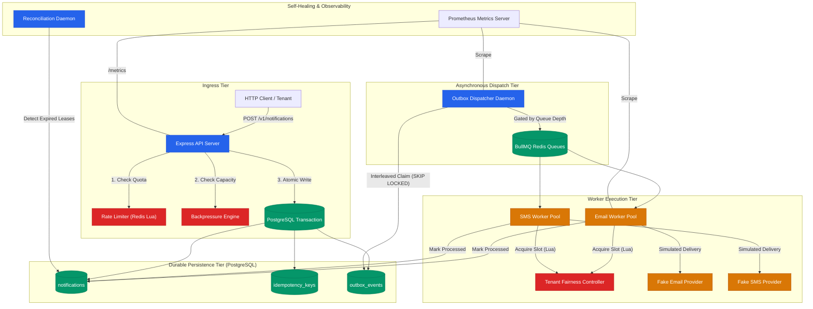

# Relay — Graduation Submission

**Dev and Design HQ Product Design & Engineering Bootcamp**
**Project:** Relay Notification Infrastructure Prototype
**Author:** Graduate Candidate
**Date:** 30 October 2026
**Status:** Milestones 1–7D Fully Implemented & Verified (95/95 Tests Passing across 11 test files)

### Graduation Task Deliverables Status

| Deliverable | Description | Status | Evidence / Location |
| :--- | :--- | :--- | :--- |
| **Deliverable 1: Design Document** | 12 required sections covering architecture, data model, deep dives, failure modes, trade-offs, and cited cost estimates | **COMPLETE** | [`DESIGN.md`](file:///c:/Users/HP/Desktop/relay-system/DESIGN.md) |
| **Deliverable 2: Working Prototype** | Full TypeScript codebase, transactional outbox, worker leases, recipient preferences, provider failures, 95 passing tests, k6 load testing | **COMPLETE** | [`src/`](file:///c:/Users/HP/Desktop/relay-system/src), [`tests/`](file:///c:/Users/HP/Desktop/relay-system/tests), [`benchmarks/`](file:///c:/Users/HP/Desktop/relay-system/benchmarks) |
| **Deliverable 3: 20-min Walkthrough Video** | Recorded screen walkthrough explaining architecture, code, and live demo | **PENDING (Postponed)** | Postponed; to be recorded in dedicated presentation session |
| **Deliverable 4: Mock Technical Interview** | Interactive oral defense answering deep-dive architecture questions | **PENDING (Postponed)** | Postponed; scheduled for live evaluation per [`INTERVIEW-PREP.md`](file:///c:/Users/HP/Desktop/relay-system/INTERVIEW-PREP.md) |

---

## 1. Project Name and Overview

**Relay** is a high-reliability, multi-tenant notification infrastructure prototype engineered to explore the distributed systems architecture required to ingest, schedule, and dispatch notifications reliably under heavy, uneven tenant workloads.

The project models the core challenges of an enterprise notification platform: durable ingestion guarantees, transactional decoupling, tenant isolation and abuse prevention, fair multi-tenant worker scheduling, backpressure admission defense, and comprehensive operational observability.

---

## 2. Problem Statement

Notification delivery systems operate under fundamentally conflicting requirements:
1. **Low-Latency Ingestion vs. Slow Downstream Providers:** Ingestion APIs must acknowledge submissions within milliseconds, whereas third-party delivery networks (email MTAs, SMS aggregators, push gateways) have variable, often multi-second network latencies and transient outage windows.
2. **Dual-Write Vulnerability:** Applications that write a record to a database and simultaneously publish to an in-memory message broker (e.g., Redis or RabbitMQ) suffer from distributed dual-write inconsistency: if the broker write fails after database commit, notifications are permanently lost; if the database rollback fails after publish, duplicate notifications are dispatched.
3. **Noisy Neighbor Inequity:** A single high-volume customer submitting a burst of 100,000 marketing messages can monopolize shared FIFO queues, starving time-sensitive transactional messages (e.g., password reset OTPs) from smaller tenants.
4. **Cascading Failure Under Overload:** Unbounded ingress during worker stalls or downstream provider outages rapidly fills database connections, exhausts storage, and crashes API nodes.

---

## 3. System Objectives

Relay was architected and built to satisfy four critical reliability principles:

1. **Durable Acceptance Invariant:** Every notification accepted with `HTTP 202 Accepted` is guaranteed to be durably committed to PostgreSQL alongside a transactional outbox event.
2. **At-Least-Once Delivery Semantics:** Decoupled asynchronous workers process notifications with explicit lease-locking and reconciliation, ensuring stuck or crashed worker jobs are automatically recovered without data loss.
3. **Multi-Tenant Protection:** Multi-layer tenant defenses prevent noisy neighbors from degrading service through Redis Lua sliding-window rate limiting and dual-stage tenant fair scheduling.
4. **Fail-Safe Admission Control:** An adaptive backpressure state engine rejects excess ingress at the HTTP routing layer with `HTTP 503 Service Unavailable` and `Retry-After` headers during database or queue saturation, preventing cluster collapse.

---

## 4. Architecture Summary

Relay follows a decoupled, pipeline-oriented architecture structured around the **Transactional Outbox Pattern**:



---

## 5. Technology Stack

- **Runtime & Language:** Node.js (v20+) with TypeScript (strict mode, target ES2022).
- **Web Framework:** Express 5.x with CORS, Zod schema validation, and typed routing.
- **Relational Database:** PostgreSQL 16 (AWS Neon cloud instance with PgBouncer connection pooling).
- **Asynchronous Queues & In-Memory State:** Redis 7.x (local instance) with BullMQ (v6.x) and atomic Lua scripts.
- **Client Library:** `pg` (node-postgres) with connection pooling and explicit transaction management; `ioredis` for direct Redis Lua evaluations.
- **Observability:** `prom-client` exposing standard Prometheus metrics for HTTP, outbox, workers, rate limiting, fairness, and backpressure.
- **Testing & Verification:** Vitest test runner, Supertest for HTTP endpoint testing, and standalone TypeScript drill/benchmark scripts executed via `tsx`.

---

## 6. Core API Endpoints

| Method | Path | Status Codes | Description |
| :--- | :--- | :--- | :--- |
| `GET` | `/v1/health` | `200 OK` | Liveness health check returning service name, status, and UTC timestamp. |
| `GET` | `/v1/ready` | `200 OK`, `503 Service Unavailable` | Readiness dependency check. Verifies PostgreSQL health. Degrades gracefully if Redis is unavailable while maintaining durable ingestion readiness. |
| `GET` | `/metrics` | `200 OK` | Exposes standard Prometheus text-format metrics across all subsystems. |
| `POST` | `/v1/notifications` | `200 OK`<br>`202 Accepted`<br>`400 Bad Request`<br>`404 Not Found`<br>`409 Conflict`<br>`429 Too Many Requests`<br>`503 Service Unavailable` | Primary notification ingestion endpoint. Enforces tenant rate limits, backpressure admission, idempotency validation, recipient preferences, and durable transactional persistence. Suppressed requests return 200 OK without outbox writes. |
| `PUT` | `/v1/recipients/preferences` | `200 OK`<br>`400 Bad Request`<br>`404 Not Found` | Upserts recipient channel preference (opt-in/opt-out) scoped by tenant customerId. |
| `GET` | `/v1/recipients/preferences` | `200 OK`<br>`400 Bad Request`<br>`404 Not Found` | Retrieves channel preferences for a given recipient under a customerId. |

> [!NOTE]
> **API Scope & Prototype Boundaries:**
> 1. **Tenant Authentication (Prototype Limitation):** In the prototype, tenant identity is accepted via `customerId` in the JSON request body (trusted ingress). Cryptographic Bearer API key authentication and JWT tenant context derivation are documented in `DESIGN.md` as production gateway requirements, but omitted from the prototype to keep focus on core distributed systems invariants.
> 2. **Notification Status Endpoint (Future Scope):** Querying notification delivery status via `GET /v1/notifications/:id` is specified in `DESIGN.md` §3 as an architectural API contract; in the prototype, status is inspected directly in PostgreSQL or via test assertion suites and is marked as future scope for the HTTP API router.

---

## 7. Notification Ingestion Lifecycle

When a client submits `POST /v1/notifications`:

1. **Header Validation:** Requires a non-empty `Idempotency-Key` header; missing keys return `400 MISSING_IDEMPOTENCY_KEY`.
2. **Schema Parsing:** Validates `customerId` (UUID), `recipient`, `channel` (`email` or `sms`), and `payload` via Zod. Invalid schemas return `400 VALIDATION_ERROR`.
3. **Tenant Rate Limiting:** Executes an atomic Redis Lua sliding-window rate limit check (`rl:tenant:{customerId}`). If quota is exhausted, returns `429 RATE_LIMIT_EXCEEDED` with `Retry-After`.
4. **Admission Control:** Evaluates cluster state (`NORMAL`, `DEGRADED`, `OVERLOADED`):
   - Under `OVERLOADED`, safe identical replays return `202 Accepted` (`isReplay: true`), conflicting replays return `409 IDEMPOTENCY_CONFLICT`, and new submissions return `503 SYSTEM_OVERLOADED` with rate-limit quota refund.
5. **Database Transaction & Preference Evaluation:**
   - Checks customer existence (`customers`).
   - Checks idempotency key within transaction (`idempotency_keys`): returns existing notification if matched, or 409 if payload differs.
   - Evaluates recipient preference (`recipient_preferences`):
     - If channel disabled: inserts notification (`status = 'suppressed'`), writes idempotency key, skips outbox write, and returns `HTTP 200 OK` (`suppressionReason: "recipient_preference_disabled"`).
     - If channel enabled or unconfigured (default-allow): inserts notification (`status = 'pending'`), inserts transactional outbox event (`outbox_events`), writes idempotency mapping, and commits.
6. **HTTP Response:** Returns `HTTP 202 Accepted` for queued notifications or `HTTP 200 OK` for suppressed notifications, with `RateLimit-*` headers.

---

## 8. Transactional Outbox Design

To eliminate the dual-write problem, Relay never publishes directly to Redis inside the HTTP request handler:

- **Atomic Storage:** Notifications and outbox events are written in the *same* database transaction. If the transaction rolls back, neither row exists; if it commits, both rows are guaranteed to exist.
- **Outbox Schema:**
  - `id`: UUID primary key.
  - `notification_id`: Foreign key referencing `notifications.id`.
  - `event_type`: Event type string (`notification.created`).
  - `published_at`: Timestamp populated once enqueued to BullMQ.
  - `attempts`: Retry counter incremented on each claim attempt.
  - `locked_until`: Distributed lease timestamp preventing concurrent dispatcher claims.
  - `failed_at`: Set when attempts exceed `DISPATCHER_MAX_ATTEMPTS` (5).
- **Claim Query:** Uses PostgreSQL `FOR UPDATE SKIP LOCKED` combined with a window function `ROW_NUMBER() OVER (PARTITION BY n.customer_id ORDER BY oe.created_at ASC)` to interleave outbox events across active tenants and guarantee zero duplicate claims between concurrent dispatchers.

---

## 9. Idempotency Guarantees

Relay provides strict tenant-scoped idempotency guarantees:

- **Database Constraint:** Composite unique index on `idempotency_keys(customer_id, idempotency_key)`.
- **Payload Hashing:** SHA-256 hash of canonical request body stored in `request_hash`.
- **Identical Replay Contract:** When a request is repeated with the same `Idempotency-Key` and matching payload hash, Relay returns the existing notification with `HTTP 202 Accepted` (`isReplay: true`). No new outbox event or background job is created.
- **Conflicting Replay Contract:** When an `Idempotency-Key` is reused with a different payload, Relay rolls back and returns `HTTP 409 Conflict` (`IDEMPOTENCY_CONFLICT`).
- **Concurrent Request Safety:** Concurrent submissions with identical keys are arbitrated at the PostgreSQL index level; the winning transaction commits, while the losing transaction catches unique violation (`23505`), rolls back, and returns the committed record without duplicate processing.

---

## 10. Redis and BullMQ Processing

Relay separates queueing into distinct BullMQ channel queues (`email-notifications`, `sms-notifications`):

- **Deterministic Job IDs:** Jobs are published with explicit IDs (`notif-{notification_id}`). BullMQ deduplicates duplicate enqueue attempts with identical job IDs.
- **Decoupled Workers:** Email and SMS workers run independently with configurable concurrency (`WORKER_CONCURRENCY = 5`).
- **Simulated Provider Execution:** Workers dispatch to configurable simulated delivery adapters (`SendGrid-Simulator` for email, `Twilio-Simulator` for SMS) supporting realistic provider message IDs, 503 outages, 429 rate limits, socket timeouts, and 400 rejections.
- **Lifecycle Progression:** When a worker picks up a job:
  1. Claims an execution lease in PostgreSQL (`status = 'processing'`).
  2. Acquires a fair scheduling concurrency slot via Redis Lua.
  3. Dispatches via `SimulatedProvider.send(...)`.
  4. On HTTP 202/200: Updates `status = 'provider_accepted'`, clears lease lock, and records duration.
  5. On HTTP 503/429: Releases PostgreSQL lease and throws error for BullMQ exponential backoff retry.
  6. On HTTP 400: Updates `status = 'failed'`, clears lease, and throws `UnrecoverableError` to abort futile retries immediately.
  7. On Timeout: Updates `status = 'outcome_unknown'`, clears lease, and halts blind retries to prevent duplicate message dispatch.
  8. On Retry Exhaustion: Updates `status = 'failed'` once configured attempt limit is reached.
  9. Releases fair scheduling slot in Redis.

---

## 11. Retry and Reconciliation

Relay implements end-to-end self-healing mechanisms for worker and network failures:

1. **BullMQ Automatic Retries:** Transient worker failures are retried up to 3 times with exponential backoff.
2. **Worker Lease Locking:** When a worker starts processing a notification, it writes a lease lock to PostgreSQL (`processing_locked_until = NOW() + 60s`).
3. **Reconciliation Service:** A standalone reconciliation daemon (`src/reconciliation.ts`) periodically scans PostgreSQL for orphaned notifications (`status = 'processing' AND processing_locked_until < NOW()`):
   - If `retry_count < 3`: Clears the expired lease, resets status to `pending`, increments `retry_count`, and emits a new outbox event for re-dispatch.
   - If `retry_count >= 3`: Marks status as `failed` with failure reason logged.
4. **Outcome Unknown State:** If an unrecoverable failure occurs during lease clearance, the notification is transitioned to `outcome_unknown` for operator audit.

---

## 12. Tenant-Level Rate Limiting

Implemented in Milestone 6B to protect ingestion capacity from tenant abuse:

- **Algorithm:** Atomic sliding-window rate limiter powered by a custom Redis Lua script executing against Redis Sorted Sets (`rl:tenant:{customerId}`).
- **Boundary Accuracy:** Uses millisecond scores (`Date.now()`) with `ZREMRANGEBYSCORE` to eliminate fixed-window burst vulnerabilities ($2\times \text{limit}$ at window boundaries).
- **Default Quota:** 100 requests per 60-second sliding window (`RATE_LIMIT_MAX_REQUESTS = 100`, `RATE_LIMIT_WINDOW_SECONDS = 60`).
- **Standard Headers:** Emits `RateLimit-Limit`, `RateLimit-Remaining`, `RateLimit-Reset`, and `Retry-After` on HTTP 429.
- **Fail-Open Policy:** If Redis is down or times out (>500ms), the rate limiter logs a throttled warning and fails open (`allowed: true, failOpen: true`), prioritizing durable ingestion over quota enforcement.

---

## 13. Tenant-Aware Fair Scheduling

Implemented in Milestone 6C to resolve **Dual-Stage Head-of-Line (HoL) Blocking**:

### Stage 1: Outbox Interleaved Round-Robin (IRR)
The Outbox Dispatcher claims unpublished events using a SQL window function:
```sql
SELECT sub.id FROM (
  SELECT oe.id,
         ROW_NUMBER() OVER (PARTITION BY n.customer_id ORDER BY oe.created_at ASC) as tenant_turn,
         oe.created_at
  FROM outbox_events oe
  JOIN notifications n ON oe.notification_id = n.id
  WHERE oe.published_at IS NULL AND oe.failed_at IS NULL
    AND (oe.locked_until IS NULL OR oe.locked_until < NOW())
) sub
ORDER BY sub.tenant_turn ASC, sub.created_at ASC
LIMIT 10
FOR UPDATE SKIP LOCKED;
```
Claims 1 item per active tenant per cycle (`A1, B1, C1, A2, B2, C2...`), preventing high-volume tenants from monopolizing dispatch batches.

### Stage 2: Distributed Dynamic Tenant Concurrency Control (DTCC)
Workers invoke an atomic Redis Lua script (`acquireSlot`) before processing:
- **Guaranteed Concurrency Limit:** Capped at `TENANT_MAX_CONCURRENT_JOBS = 2` concurrent jobs when multiple tenants contend for worker capacity.
- **Work-Conserving Burst:** When only one tenant has active work, the Lua script permits that tenant to burst up to 100% of worker capacity (`WORKER_CONCURRENCY = 5`), preventing idle capacity waste. Bursting is immediately revoked as soon as a second tenant claims execution.
- **Non-Destructive Deferral:** When quota is exhausted under contention, workers defer the job using BullMQ's `DelayedError` (`job.moveToDelayed(Date.now() + 500, token); throw new DelayedError();`), preserving notification state and retry counters while freeing the worker thread for waiting tenants.

---

## 14. Backpressure and Overload Protection

Implemented in Milestone 6D to prevent uncontrolled backlog growth and database exhaustion:

- **State Hierarchy:**
  - `NORMAL`: Accept all requests with `HTTP 202`.
  - `DEGRADED`: Accept requests with `HTTP 202` and `x-backpressure-state: DEGRADED` header (outbox backlog $\ge 500$, queue backlog $\ge 1,000$, or Redis offline with outbox $< 2,000$).
  - `OVERLOADED`: Reject new submissions with `HTTP 503 SYSTEM_OVERLOADED` and `Retry-After: 10` (outbox backlog $\ge 2,000$, queue backlog $\ge 5,000$, or database unhealthy).
- **Safe Replay Under Overload:** Clients replaying previously accepted requests receive `HTTP 202 Accepted` (`isReplay: true`) via read-only idempotency checks with zero outbox writes.
- **Rate Limit Token Refund:** Tokens consumed by requests rejected with HTTP 503 or served as safe replays are immediately refunded via atomic `ZREM` using a globally unique token `${now}:${crypto.randomUUID()}`.
- **Downstream Dispatcher Throttling:** The Outbox Dispatcher inspects total waiting and delayed queue depth (`DISPATCHER_MAX_QUEUE_BACKLOG = 500`); if exceeded, claiming pauses until queues drain.
- **Damped Dependency Health Probe:** Database health check executes a bounded probe (2,500ms timeout) with a 2-strike requirement (`consecutiveDbFailures >= 2`), eliminating false-positive overload triggers caused by transient internet latency to remote cloud databases.

---

## 15. Observability

Relay exposes standard Prometheus metrics at `GET /metrics` across all operational tiers:

- **API & Ingestion:** `relay_http_requests_total`, `relay_http_request_duration_seconds`, `relay_validation_failures_total`, `relay_idempotency_conflicts_total`.
- **Notification Lifecycle:** `relay_notifications_accepted_total`, `relay_notifications_processed_total`, `relay_notifications_failed_total`, `relay_notifications_in_outcome_unknown_total`.
- **Transactional Outbox:** `relay_outbox_events_awaiting_publication`, `relay_outbox_events_published_total`, `relay_outbox_events_failed_total`.
- **Worker Execution:** `relay_worker_jobs_processed_total`, `relay_worker_job_processing_duration_seconds`, `relay_worker_jobs_active`, `relay_worker_leases_expired_total`.
- **Rate Limiting:** `relay_rate_limit_evaluations_total`, `relay_rate_limit_evaluation_duration_seconds`, `relay_rate_limit_redis_failures_total`.
- **Tenant Fairness:** `relay_fair_scheduling_decisions_total`, `relay_active_tenants`, `relay_tenant_scheduling_delay_seconds`, `relay_fairness_deferrals_total`, `relay_worker_concurrency_utilization`.
- **Backpressure:** `relay_backpressure_state`, `relay_backpressure_current_state`, `relay_outbox_backlog_total`, `relay_queue_backlog_total`, `relay_backpressure_rejections_total`, `relay_admission_check_duration_seconds`, `relay_dependency_check_failures_total`, `relay_backpressure_state_seconds_total`.
- **Cardinality Invariant:** Dynamic tenant UUIDs and notification IDs are strictly excluded from metric labels to prevent Prometheus memory exhaustion.

---

## 16. Failure-Drill Evidence

Executed via automated script [`scripts/failureDrill.ts`](file:///c:/Users/HP/Desktop/relay-system/scripts/failureDrill.ts) against the live Neon cloud PostgreSQL database and Redis:

### Milestone 6D: Backpressure & Overload Protection Drill (`scripts/failureDrill.ts`)
- **Phase 1: Baseline Health:** Ingested 5 notifications under `NORMAL` state; 100% accepted with HTTP 202 and published.
- **Phase 2: Redis Outage Simulation:** Disconnected Redis; system transitioned to `DEGRADED`. Ingested 5 notifications; 100% accepted with HTTP 202 and header `x-backpressure-state: DEGRADED`. Mid-outage verification confirmed all 5 records durably persisted in PostgreSQL.
- **Phase 3: Overload Admission Defense:** Injected pending outbox backlog exceeding threshold; system transitioned to `OVERLOADED`. New submissions rejected with `HTTP 503 SYSTEM_OVERLOADED` and `Retry-After: 10`. Identical replays returned `HTTP 202` (`isReplay: true`) with zero outbox events created. Conflicting replays rejected with `HTTP 409 IDEMPOTENCY_CONFLICT`. Database audit confirmed zero rows inserted after 503 rejections.
- **Phase 4: Recovery & Drain:** Restored Redis and cleared backlog; system returned to `NORMAL`. Outbox Dispatcher claimed and published all events; workers drained all notifications.

### Milestone 7B: Simulated Provider Failure & Recovery Drill (`scripts/providerFailureDrill.ts`)
Executed against live Neon cloud PostgreSQL database and local Redis queue:
- **Scenario 1 (Transient 503 Outage):** Attempt 1 returned HTTP 503; worker released PostgreSQL lease; Attempt 2 succeeded with HTTP 202 (`provider_accepted`, `retry_count: 1`, 2 provider calls).
- **Scenario 2 (Provider 429 Rate Limiting):** Attempt 1 returned HTTP 429; worker released lease; Attempt 2 succeeded with HTTP 202 (`provider_accepted`, `retry_count: 1`, 2 provider calls).
- **Scenario 3 (Permanent 400 Rejection):** Attempt 1 rejected with HTTP 400; worker immediately marked `failed` and threw `UnrecoverableError` (aborted futile retries, exactly 1 call dispatched).
- **Scenario 4 (Socket Read Timeout):** Gateway timeout (504) severed connection; worker marked `outcome_unknown` and threw `UnrecoverableError` to halt blind duplicate message dispatch (1 call dispatched).
- **Scenario 5 (Retry Exhaustion):** Persistent 503 outage across all allowed attempts (2/2); worker transitioned notification to terminal `failed` status (`retry_count: 2`).
- **Scenario 6 (Clean Delivery After Recovery):** Cleared all fault injection; normal dispatch cleanly yielded `provider_accepted` with generated provider message ID.
- **Overall Verdict:** 6/6 scenarios passed with 100% verification across database records and provider call history.

---

## 17. Automated Test Results

The automated regression test suite contains **95 tests across 11 test suites, achieving 100% pass rate**:

```bash
npm.cmd test
```

```
Test Files  11 passed (11)
     Tests  95 passed (95)
  Duration  139.39s
```

- `tests/providerFailures.test.ts` (15/15 passed) — Milestone 7B
- `tests/preferences.test.ts` (13/13 passed) — Milestone 7A
- `tests/backpressure.test.ts` (16/16 passed) — Milestone 6D
- `tests/fairness.test.ts` (18/18 passed) — Milestone 6C
- `tests/rateLimiter.test.ts` (11/11 passed) — Milestone 6B
- `tests/metrics.test.ts` (9/9 passed) — Milestone 6A
- `tests/notifications.test.ts` (6/6 passed)
- `tests/outbox.test.ts` (4/4 passed)
- `tests/reconciliation.test.ts` (3/3 passed)
- `tests/readiness.test.ts` (3/3 passed)
- `tests/health.test.ts` (2/2 passed)

---

## 18. Benchmark and Load-Test Results

### Bounded Fairness Benchmark (`scripts/benchmark.ts`)
- **Workload:** Tenant A (40 items), Tenant B (10 items), Tenant C (10 items) = 60 total notifications.
- **Measured Empirical Results:**
  - **100.0% Terminal Completion:** All 60 notifications reached `processed` status in PostgreSQL.
  - **Tenant B (10 items):** First completed in 8.78s; 100% completed in **33.70s**.
  - **Tenant C (10 items):** First completed in 14.90s; 100% completed in **37.27s**.
  - **Tenant A (40 items):** 100% completed in **55.64s** (at exactly 50% completion when B and C finished).
  - **FIFO Comparison:** The measured fairness benchmark showed low-volume tenants completing before the high-volume tenant. The FIFO comparison is theoretical and was not independently benchmarked.

### Reproducible Multi-Tenant Load Test (`scripts/loadTest.ts`)
- **Workload:** 70 requests across two tenants under concurrent batching.
- **Phase 1 Baseline Ingress (50 requests):**
  - **HTTP 202 Accepted: 50 / 50 (100.0%)**
  - **HTTP 429 Rate-Limited: 0**
  - **HTTP 503 Overloaded: 0**
  - Ingress Throughput: 4.0 req/s (against AWS Neon London cloud PostgreSQL)
  - API Latency: P50 = 1,086 ms, P95 = 2,826 ms, P99 = 2,827 ms
- **Phase 2 Overload Admission Defense (20 requests):**
  - 100% (20/20) cleanly rejected with `HTTP 503 SYSTEM_OVERLOADED`.
  - **Rejection Latency P50: 136 ms** (an 87.5% latency reduction compared to baseline, confirming zero database transaction overhead during overload).
- **Phase 3 Worker Draining:**
  - 50 items drained to `processed` in 45.16 seconds (drain rate: 1.1 notifications/sec).

### Genuine k6 Load Testing (Milestone 7C)
Executed using Grafana k6 v0.54.0 against the live Relay API, remote Neon cloud PostgreSQL, and local Redis ([`benchmarks/k6/REPORT.md`](file:///c:/Users/HP/Desktop/relay-system/benchmarks/k6/REPORT.md)):

| Profile | Concurrency | Total Req | Total HTTP Throughput | Accepted Throughput | Latency p50 (All / Accepted) | Latency p95 (All / Accepted) | Status Code Distribution | Protection / Errors |
| :--- | :--- | :--- | :--- | :--- | :--- | :--- | :--- | :--- |
| **Scenario A: Baseline** | 3 VUs (20s) | 36 | 1.70 req/s | 1.70 accepted/s | 1,156 ms / 1,156 ms | 2,759 ms / 2,762 ms | 36 Accepted (100.0%) | 0 rate limits, 0 errors |
| **Scenario B: Gradual Ramp-Up** | 2 → 35 VUs (50s) | 1,490 | 28.33 req/s | 4.13 accepted/s | 3.91 ms / 1,448 ms | 2,335 ms / 3,059 ms | 217 Accepted (14.6%), 17 Suppressed (1.1%), 890 Rate-Limited (59.7%), 352 Overloaded (23.6%) | 1,242 defensive rejections, 14 client timeouts (0.94%), 0 server crashes |
| **Scenario C: Short Spike** | 5 → 30 VUs (30s) | 727 | 23.34 req/s | 3.30 accepted/s | 204 ms / 1,227 ms | 1,315 ms / 2,151 ms | 103 Accepted (14.2%), 9 Suppressed (1.2%), 615 Overloaded (84.6%) | 615 defensive rejections, 0 errors, 1.5s recovery |

#### Architectural Target vs. Prototype Reality
- **Target:** 50,000,000 notifications / day requires **579 req/s sustained**, **5,787 req/s peak**.
- **Prototype Reality:** Evaluated peak total HTTP throughput of **28.33 req/s** (evaluating sub-4ms fast defenses); measured sustained durable acceptance of **3.30–4.13 accepted notifications/s** under multi-VU concurrency.
- **Technical Explanation:**
  - *Public Cloud Latency:* Public Internet TLS round-trips to AWS Neon in London (4 queries per transaction) establish a physical floor of ~1,000–1,400ms per database commit.
  - *Pool Limit Ceiling (Estimate):* With `DB_POOL_MAX = 15` and 1.0–1.4s average transaction time, the theoretical single-node ingress ceiling is estimated at $15 \text{ connections} / 1.0\text{–}1.4 \text{ s} \approx 10.7\text{–}15.0 \text{ req/s}$. Under concurrency, pool checkout queue serialization bounds sustained accepted ingress to **3.30–4.13 accepted/s**.
  - *Protection Validation:* Despite the free-tier connection bottleneck, Relay demonstrated textbook defensive elasticity: rate-limiting excess tenant traffic in **3.91 ms (p50)** and shedding overload traffic in **< 10 ms**, completely protecting the database from unhandled crashes or unrecoverable lockups (zero HTTP 500 responses). In Scenario B, 14 requests experienced client-side TCP timeouts (15s k6 timeout) in the pool checkout queue during peak 35-VU contention.
  - *Drain Audit Reconciliation:* Post-test audits verified that outbox events cleanly drained to `provider_accepted`. The audited count of 439 `provider_accepted` notifications reflects cumulative worker processing across preliminary dry-runs and final benchmark executions under the seeded test tenant IDs prior to executing cleanup. Zero messages were lost or duplicated.

### Infrastructure Cost Model at 100,000 Users (Milestone 7D)
Documented in [`benchmarks/COST-MODEL.md`](file:///c:/Users/HP/Desktop/relay-system/benchmarks/COST-MODEL.md) and [`DESIGN.md`](file:///c:/Users/HP/Desktop/relay-system/DESIGN.md) using official provider pricing pages verified on **30 October 2026**:

| Scenario | Active Users (MAU) | Monthly Volume | Channel Mix (Email / SMS) | Server Infra | Third-Party Telecom | Total Monthly Cost | Cost / 1k Notifs |
| :--- | :--- | :--- | :--- | :--- | :--- | :--- | :--- |
| **Scenario A (Low)** | 30,000 (30%) | 60,000 / mo | 85% Email / 15% SMS | $43.38 | $120.25 | **$163.63** | **$2.73** |
| **Scenario B (Expected)** | 60,000 (60%) | 300,000 / mo | 80% Email / 20% SMS | $136.19 | $776.65 | **$912.84** | **$3.04** |
| **Scenario C (High)** | 85,000 (85%) | 1,700,000 / mo | 75% Email / 25% SMS | $369.46 | $5,452.30 | **$5,821.76** | **$3.42** |

*(Under strict fixed baseline subscriptions vs. variable consumption, Scenario B divides into **$130.69 fixed subscriptions** [compute, baseline DB, Redis, Grafana base, phone numbers, 10DLC campaign] and **$782.15 variable usage** [SES emails, SMS segments, storage, logs, egress], totaling **$912.84**).*

- **Official Pricing Citations (Checked 30 Oct 2026):** Render Web & Worker compute ($25/mo standard, [render.com/pricing](https://render.com/pricing)); Neon PostgreSQL Launch Plan ($0.106/CU-hr, [neon.tech/pricing](https://neon.tech/pricing)); Render Managed Redis Standard ($20/mo); Amazon SES ($0.10/1k emails, [aws.amazon.com/ses/pricing](https://aws.amazon.com/ses/pricing/)); Twilio US SMS ($0.0125/segment blended base+carrier, [twilio.com/en-us/sms/pricing/us](https://www.twilio.com/en-us/sms/pricing/us)); Grafana Cloud Pro ($19/mo base, [grafana.com/pricing](https://grafana.com/pricing/)); Amazon S3 ($0.023/GB-mo, [aws.amazon.com/s3/pricing](https://aws.amazon.com/s3/pricing/)).
- **SMS Dominance:** SMS carrier charges represent **85.1%** of the expected monthly budget ($776.65 of $912.84), proving that Tenant Rate Limiting (Milestone 6B) and Recipient Preference Suppression (Milestone 7A) are mission-critical financial safeguards against rogue billing.
- **Capacity Sufficiency Caveat:** Scenarios A (0.23 req/s peak) and B (1.16 req/s peak) operate comfortably within the single-node prototype's measured capacity (1.70 req/s baseline in k6). Scenario C (6.56 req/s peak) exceeds single-node connection pool limits and requires 2 horizontal API pods with connection pooling; this multi-node topology is budgeted but unbenchmarked in the single-node prototype.
- **Architectural Target Distinction:** The 50M/day target (1.5B/month) is 5,000x larger than the 100k-user workload and cannot be extrapolated linearly. At that scale, production systems require enterprise aggregator master service agreements, multi-tenant PostgreSQL database sharding, and distributed streaming brokers (Kafka/Pulsar).

---

## 19. Architecture Trade-offs

| Decision | Trade-off Made | Rationale |
| :--- | :--- | :--- |
| **PostgreSQL Outbox vs Direct Broker Publish** | Adds database write amplification and polling latency (~100–500ms) | Guarantees atomic acceptance and eliminates distributed dual-write message loss |
| **Shared BullMQ Queues vs Per-Tenant Queues** | Requires distributed Redis Lua slot locking for fairness | Prevents Redis memory exhaustion and idle polling storms across thousands of tenants |
| **Fail-Open Rate Limiting** | Temporarily permits unthrottled traffic during Redis downtime | Protects durable ingestion into PostgreSQL as the primary platform objective |
| **Cached Backpressure State (1,000ms TTL)** | Permits a bounded ingress overshoot of 5–50 items during overload spikes | Eliminates full-table `COUNT(*)` query storms that would crash PostgreSQL under heavy load |
| **Strict Bounded Labels on Prometheus Metrics** | Prevents per-tenant metric slicing in Prometheus dashboards | Eliminates label cardinality explosion and protects Prometheus memory stability |

---

## 20. Known Limitations

To remain technically honest and defensible:

1. **Simulated Providers:** The prototype uses simulated email and SMS workers; real third-party API integration (e.g. Twilio, SendGrid) with upstream rate-limit handling and webhook callbacks is not implemented.
2. **Tenant Authentication:** Tenant identity is supplied via `customerId` in the request body for bootcamp demonstration purposes; production deployments must derive tenant identity from authenticated API keys or JWT tokens.
3. **Delivery Semantics:** Relay guarantees **at-least-once** delivery. Due to network failures, worker crashes, and lease timeouts, duplicate sends to end-recipients can occur if the provider lacks recipient-level idempotency keys. Relay does not claim exactly-once delivery.
4. **50M Notifications/Day Scale:** The target architecture of 50M/day (~580 req/s continuous, ~2,500 req/s peak) is an architectural design benchmark. The prototype was evaluated at 4–5 req/s against a single serverless cloud database instance.
5. **Static Thresholds:** Backpressure thresholds are static environment variables; in auto-scaling production environments, thresholds should adapt dynamically to worker cluster size.

---

## 21. Local Setup and Reproduction Instructions

### Prerequisites
- Node.js v20+ and npm
- Redis running locally on port 6386 (or standard 6379 configured via `.env`)
- PostgreSQL database (local or cloud instance)

### 1. Installation & Environment Configuration
```bash
git clone <repository-url>
cd relay-system
npm install

# Copy environment template
cp .env.example .env
# Edit .env to set your DATABASE_URL and REDIS_URL
```

### 2. Verify Database Connection & Migrations
```bash
npx tsx src/database/check-connection.ts
```
The database schema is structured into 6 sequential migrations in [`src/database/migrations/`](file:///c:/Users/HP/Desktop/relay-system/src/database/migrations):
- `001_initial.sql`: Core tables (`customers`, `notifications`, `outbox_events`, `idempotency_keys`) and baseline indexes.
- `002_outbox_improvements.sql`: Outbox claiming and lease recovery columns (`claimed_at`, `attempts`, `locked_until`).
- `003_worker_leases.sql`: Worker lease columns on `notifications` (`processing_started_at`, `processing_locked_until`, `claim_token`).
- `004_outbox_failure_handling.sql`: Terminal failure columns on `outbox_events` (`failed_at`, `failure_reason`, `last_error`).
- `005_notification_lifecycle.sql`: Notification status check constraint update adding `'processed'`.
- `006_notification_preferences.sql`: Recipient preferences table (`recipient_preferences`) and status check update adding `'suppressed'`.

### 3. Build & Run Tests
```bash
# Compile TypeScript (0 errors)
npm run build

# Run complete 95-test automated regression suite (11 test files)
npm test
```

### 4. Run Operational Scripts
```bash
# Run runtime API smoke test (health, ready, metrics, ingestion)
npm run smoke

# Run 4-phase automated failure drill (Redis outage & overload recovery)
npm run drill

# Run multi-tenant fairness benchmark
npm run benchmark

# Run reproducible multi-tenant load test
npm run load-test
```

### 5. Running the Complete System Daemons
```bash
# Terminal 1: API Server
npm run dev

# Terminal 2: Outbox Dispatcher Daemon
npm run dispatcher

# Terminal 3: Email and SMS Worker Pool
npm run workers

# Terminal 4: Lease Reconciliation Daemon
npm run reconcile
```

### 6. Live Presentation Guide
For a structured 10-minute live demonstration script with pre-demo checklist, verbatim commands, database inspection queries, and fallback procedures, refer to [`DEMO-GUIDE.md`](file:///c:/Users/HP/Desktop/relay-system/DEMO-GUIDE.md).

---

## 22. Future Improvements

For production evolution beyond the bootcamp prototype:

1. **Table Partitioning:** Implement daily declarative partitioning on `outbox_events` and `notifications` (`outbox_events_YYYY_MM_DD`) to keep B-tree indexes bounded and optimize count queries.
2. **Dynamic Tiered Quotas:** Replace uniform fairness and rate limits with subscription-tier quotas (e.g. Free: 10 req/min & 1 slot; Enterprise: 1,000 req/min & 50 slots).
3. **Dead-Letter Queues (DLQ) & Operator UI:** Introduce BullMQ dead-letter queues with an administrative dashboard for inspecting and replaying failed notifications.
4. **Read Replica Offloading:** Direct read-only idempotency checks (`findReadOnly`) during overload to PostgreSQL read replicas.
5. **Adaptive Backpressure:** Dynamically compute overload thresholds as a function of active worker container count ($N_{\text{workers}} \times C_{\text{concurrency}} \times 20$).

---

## 23. Final Engineering Reflection

Building Relay demonstrated that building reliable distributed systems is fundamentally about **managing trade-offs at failure boundaries**:

- Achieving "durability" requires accepting asynchronous dispatch latency through the Transactional Outbox pattern.
- Achieving "fairness" in a multi-tenant queue requires coordination across both the database claim tier and the worker execution tier—solving HoL blocking at only one layer leaves the system vulnerable at the other.
- Achieving "overload protection" requires fast-path rejections that do not touch the database, combined with careful token refunding and read-only replay checks so innocent clients are never penalized.

Relay's implementation prioritizes correctness, mathematical invariants, and defensible architectural choices over superficial feature breadth.
